<div align="center">


# Élise OS

**The local-first, open-source home reassurance platform for families and caregivers.**

Élise learns a home’s routines from discreet sensors, highlights what is out of the ordinary
and connects an older relative to their family through the living-room TV — without ever sending their data to the cloud.

[](LICENSE)


[](https://buymeacoffee.com/drsamourai)

[🇫🇷 Français](README.md) · **🇬🇧 English**

[Live demo](https://eliseos.paulbreton.dev/demo/?lang=en) · [Website and docs](https://eliseos.paulbreton.dev/en/) · [Download](https://github.com/Elise-OS/EliseOS/releases/latest) · [☕ Support the project](https://buymeacoffee.com/drsamourai)

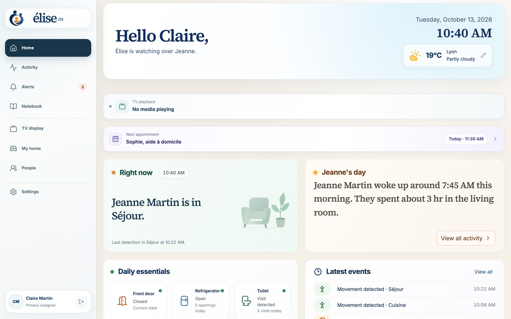

</div>

> [!IMPORTANT]
> Élise OS is a wellbeing product. It is **not a medical device or an emergency service**, and it is no substitute for professional care. An “all is well” status means Élise has adequate sensor coverage and has found no anomaly — never a guarantee of safety.

---

## Contents

- [Why Élise?](#why-élise)
- [Screenshots](#screenshots)
- [Features](#features)
- [How it works](#how-it-works)
- [Safety invariants](#safety-invariants)
- [Privacy](#privacy)
- [Hardware](#hardware)
- [Installation](#installation)
- [Remote access and mobile app](#remote-access-and-mobile-app)
- [Development](#development)
- [Repository layout](#repository-layout)
- [Tech stack](#tech-stack)
- [Documentation](#documentation)
- [Contributing, security and license](#contributing-security-and-license)

---

## Why Élise?

When a parent grows older alone at home, families are caught between two worries: not knowing, or watching too closely.
Élise offers a third way.

- **Reassure without filming.** Motion, contact, temperature and water sensors are enough to understand a day. Cameras stay optional and isolated.
- **Explain rather than alarm.** Élise learns the household’s routine for 14 days before its estimates count, and backs every alert with timestamped facts.
- **Stay connected.** The TV becomes a family screen: messages, photos, today’s appointments and video calls that pick up gently.
- **Truly stay at home.** Everything runs on a small box in the house (Raspberry Pi or Ubuntu server). Remote access goes through the family’s private Tailscale network, never exposed to the Internet.

The project is dedicated to Michel.

---

## Screenshots

Taken from the [public demo](https://eliseos.paulbreton.dev/demo/?lang=en): the fictional “Martin home”, frozen on Tuesday 13 October 2026 at 10:40. Claire, the daughter, looks after her mother Jeanne. The interface is fully bilingual; the screens below show the French locale.

### Caregiver space

|                                                                                                                    |                                                                                                     |
| :----------------------------------------------------------------------------------------------------------------: | :-------------------------------------------------------------------------------------------------: |
|                                  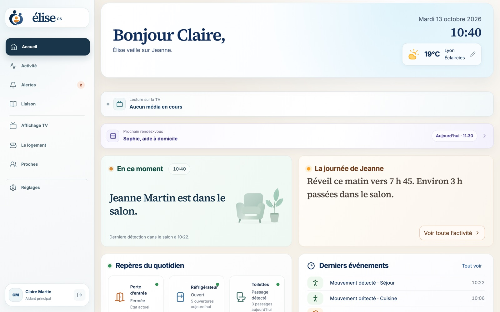                                  |                        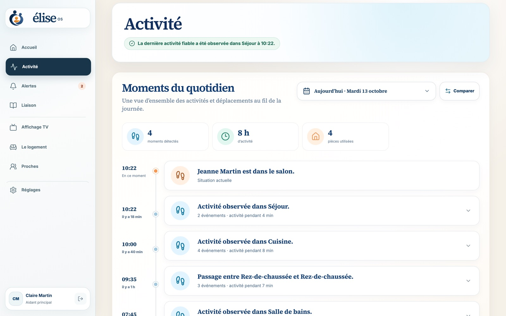                        |
|            **Home** — where Jeanne is, a summary of her day, daily essentials and the next appointment.            |                   **Activity** — a room-by-room timeline of movements and events.                   |
|                                 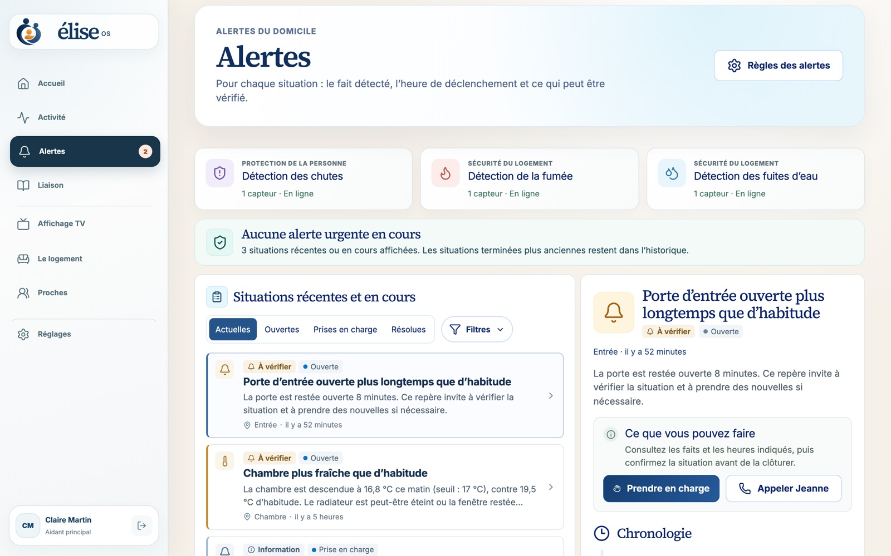                                 |                        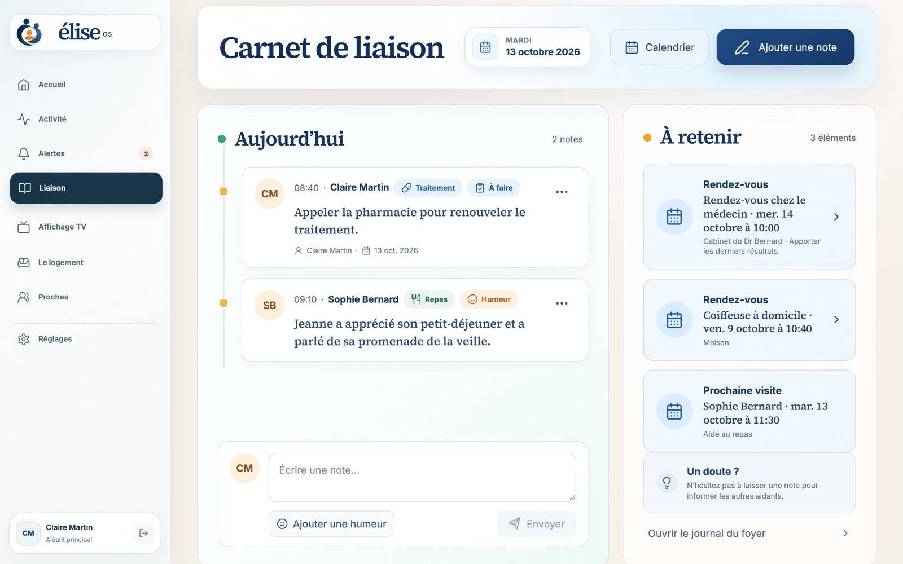                         |
| **Alerts** — each situation with the detected fact, the time and what can be checked; take ownership in one click. | **Notebook** — notes shared between caregivers (meals, mood, medication) and upcoming appointments. |
|                                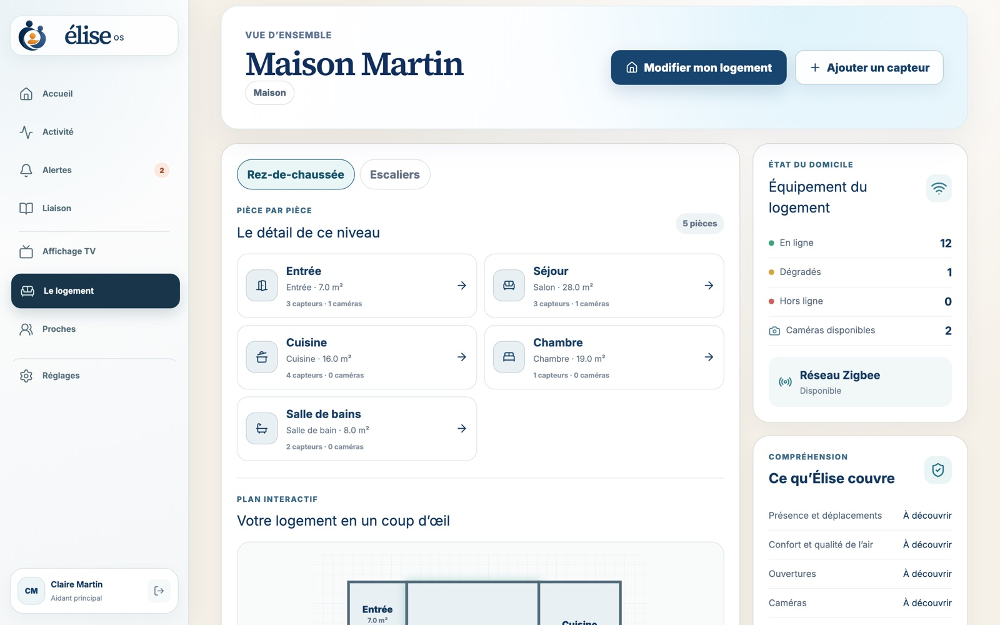                                |                         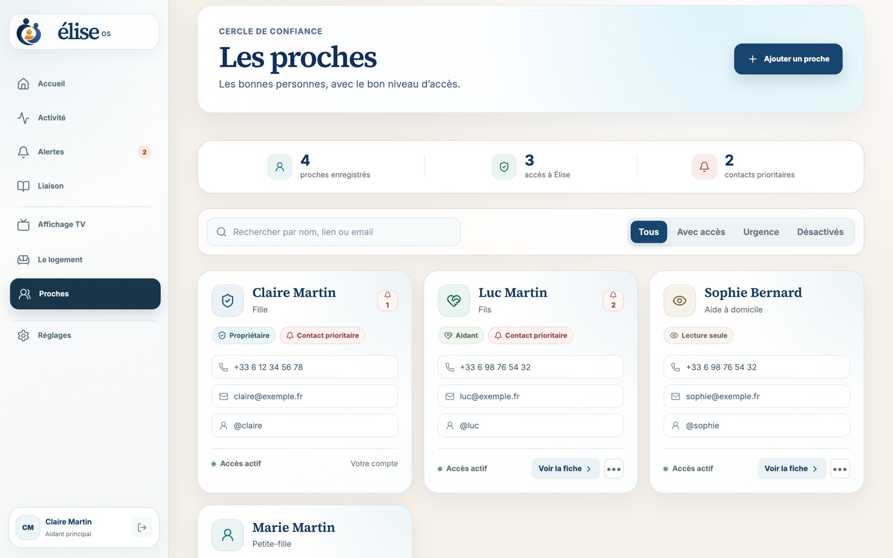                          |
|          **My home** — rooms, interactive floor plan, sensor health, Zigbee network and coverage by use.           |               **People** — the resident, the caregivers, their roles and permissions.               |
|                            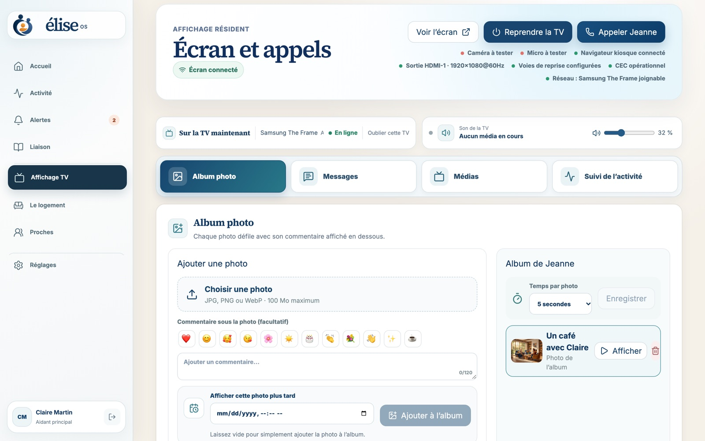                             |                        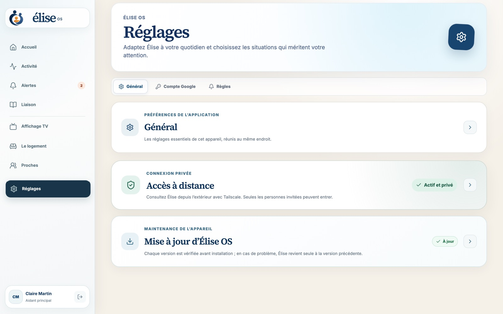                        |
|           **TV display** — messages, photos, videos, schedule and calls sent to the living-room screen.            |                      **Settings** — updates, remote access, accounts, backups.                      |

### Resident TV

<div align="center">
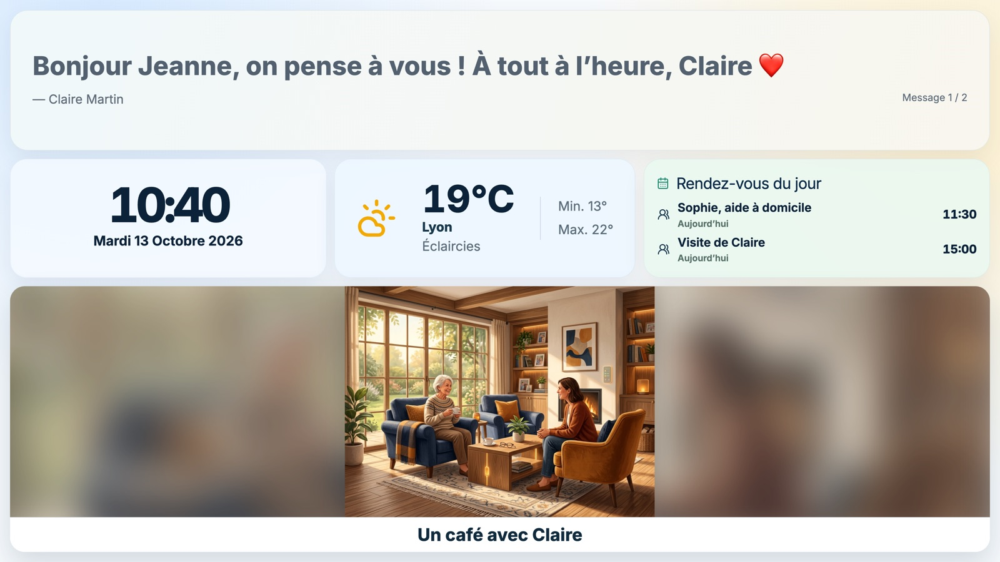
</div>

A calm screen, readable from the sofa: message of the day, clock, weather, appointments and photo album. Video calls (self-hosted Jitsi) are announced by a gently rising chime and answered with a single button.

### On a phone

<div align="center">
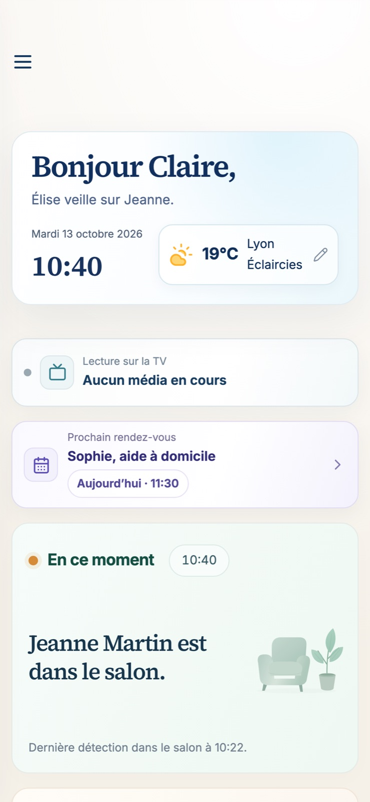
</div>

---

## Features

### Everyday reassurance

- Last detected presence and a plain-language summary of the day.
- Daily essentials: waking up, meals (fridge), bathroom, outings, front door.
- Local routine learning (Isolation Forest) with a **guarded 14-day learning period**.
- Coverage recommendations: Élise shows which rooms or uses lack sensors.

### Explainable alerts

- Falls, smoke, water leaks, door left open too long, unusual temperature, unusual inactivity…
- Family-configurable alert rules, a full lifecycle (open → acknowledged → resolved) and an auditable history.
- A sensor outage raises an **explicit system alert**, never a false inactivity claim.
- Push notifications carry minimal content; details stay behind the authenticated API.

### Caregiver coordination

- Shared notebook, visit and appointment calendar, medication tracking.
- Roles: owner, administrator, caregiver; caregivers are invited through private Tailscale access.

### TV screen and calls

- Full-screen resident interface over HDMI/DisplayPort (Chromium kiosk).
- Up to 20 rotating messages, photos, audio, videos, YouTube links and HTTPS streams.
- Self-hosted Jitsi video calls, optional auto-answer, USB button to accept or hang up.
- Automatic TV power-on through HDMI-CEC, Wake-on-LAN, or Home Assistant as a fallback.

### Home and compatibility

- **Any device exposed to Home Assistant**: Zigbee (Zigbee2MQTT), Z-Wave, Matter, Wi-Fi, Bluetooth…
- Automatic Zigbee adapter detection (Silicon Labs, Texas Instruments, ZiGate, deCONZ, ZBOSS).
- Unknown entities stay visible and can be mapped to a bounded capability (`ON_OFF`, `OPEN_CLOSED`, `NUMERIC`, `EVENT_ACTION`) without model-specific code.
- Interactive floor plan with levels, rooms and equipment.

### Cameras (optional)

- Local RTSP / ONVIF cameras through go2rtc, WebRTC viewing on a signed five-minute session.
- Privacy mode, push-to-talk intercom, alert snapshots kept for 24 hours.
- Explicit recorded consent required for bedrooms and bathrooms.

### Operations

- Flashable Raspberry Pi image, one-command Ubuntu installer, ARM64/AMD64 container images.
- Updates flagged by a badge, installed after confirmation, with **automatic rollback** if the health check fails.
- Auto-generated secrets, encrypted backups (`age`), automatic data retention.

---

## How it works

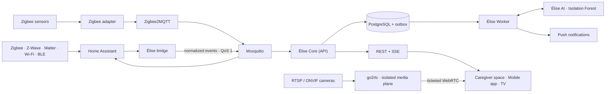

1. **Sensors** report through Home Assistant, the universal compatibility layer.
2. **The Élise bridge** maps Home Assistant entities to _capabilities_ (presence, contact, temperature…) and publishes immutable, idempotent normalized events over MQTT.
3. **Élise Core** (NestJS + Prisma) stores observations in PostgreSQL and applies the rules. A _transactional outbox_ makes deferred work recoverable.
4. **Élise Worker** drains the outbox: learning, notifications, webhooks.
5. **Élise AI** (FastAPI + scikit-learn) scores deviations from the routine. It never reads the home bus and never creates alerts: only Core decides, behind a confidence and persistence gate.
6. **The interfaces** (React dashboard, Expo app, TV screen) use the REST API and real-time SSE streams.

Home Assistant, Zigbee2MQTT and Mosquitto are internal engines: they never appear in the family experience. Architecture decisions are recorded in [`docs/adr`](docs/adr).

---

## Safety invariants

Élise is built around invariants covered by tests:

1. A sensor outage produces an explicit system alert, never an inactivity claim.
2. Machine-learning results require confidence, persistence and a Core policy gate.
3. Cold start uses only family-confirmed rules; learned scoring stays informational for at least 14 complete days.
4. Replayed events cannot create duplicate observations or SOS alerts.
5. Alert changes are append-only, auditable transitions.
6. Unknown Home Assistant capabilities are visible but ineligible for alert logic until explicitly mapped.
7. Push notifications contain only a generic status and an identifier.
8. A negative camera detection never proves absence.
9. Camera credentials, streams, images and audio never enter observations, AI features, push payloads or logs.
10. Camera access is authenticated and audited; the microphone works only as explicit push-to-talk.

---

## Privacy

All processing is **local**. No cloud service is required to run.

| Data                                | Retention                           |
| ----------------------------------- | ----------------------------------- |
| Detailed sensor observations        | 90 days                             |
| Delivery jobs and technical records | 30 days                             |
| Journal summaries                   | up to 2 years (default)             |
| Accounts and audit log              | until account or household deletion |
| Camera alert snapshots              | 24 hours, excluded from backups     |
| Video calls and audio               | never recorded                      |

Details: [docs/privacy.md](docs/privacy.md). This engineering policy supports privacy by design but is neither legal advice nor a GDPR certification.

---

## Hardware

| Item    | Recommendation                                                                                                   |
| ------- | ---------------------------------------------------------------------------------------------------------------- |
| Hub     | **Raspberry Pi 4 with 8 GB RAM** (recommended), or Pi 5 8 GB, **or** Ubuntu 24.04 AMD64 / ARM64 server with 8 GB |
| Storage | 32 GB minimum; USB SSD or NVMe (Pi 5) recommended                                                                |
| Radio   | USB Zigbee adapter (Sonoff, SMLIGHT, ConBee, ZiGate…) — optional                                                 |
| Sensors | Motion, contact, temperature/humidity, water leak, smoke, smart plug, SOS button…                                |
| Screen  | Any TV over HDMI or DisplayPort; USB webcam with microphone for two-way calls                                    |
| Cameras | Optional: any local RTSP / ONVIF camera                                                                          |

---

## Installation

### Raspberry Pi 4 / 5 (recommended)

1. Install [Raspberry Pi Imager](https://www.raspberrypi.com/software/).
2. Choose **Use custom** and the `elise-os-…img.xz` image from the [latest release](https://github.com/Elise-OS/EliseOS/releases/latest).
3. In Imager’s settings, set the hostname `elise`, your Wi-Fi, country and time zone.
4. Write the image, insert the storage and boot the Pi.
5. Open **http://elise.local** (or the Élise app on the same Wi-Fi): the “Preparing Élise” page tracks the setup, then opens the assistant that creates the administrator account.
6. Pair Tailscale from the assistant: the TV, Chromium, Jitsi and camera/microphone permissions are configured automatically.

The Zigbee adapter can be plugged in before or after: Élise detects it and picks the right driver.

### Ubuntu Server 24.04

```bash
curl -fsSL https://github.com/Elise-OS/EliseOS/releases/latest/download/install-elise.sh | sudo bash
```

The installer checks the machine, installs Docker, Tailscale and Avahi, verifies the signed release manifest, pulls the images for your architecture and waits until every service is healthy. An existing installation, its secrets and data are preserved.

### Admin commands

```bash
elise status      # service status
elise logs        # logs
elise update      # update (with automatic rollback)
elise backup      # encrypted backup
elise restore /var/lib/elise/backups/elise-YYYY.tar.age --confirm
elise uninstall   # keeps data; --purge deletes everything
```

Every release publishes the flashable image, its checksums and signatures, the Raspberry Pi Imager catalogue, the installer, the Android APK and a digest-pinned container manifest. Full guide (French): [docs/installation.md](docs/installation.md).

---

## Remote access and mobile app

**Remote access.** Élise is never published on the Internet. The family reaches the hub through its private [Tailscale](https://tailscale.com) network, on a dedicated HTTPS port. It is enabled in four steps from Settings; see [docs/acces-distant-prive.md](docs/acces-distant-prive.md).

**“Élise OS – Companion” mobile app.** Available on **iPhone and iPad (App Store)** and **Android** (APK attached to every release). It discovers the hub on the local network (`_elise._tcp.local`), verifies its identity, receives push notifications, and lets you video-call the resident or send photos to the TV.

---

## Development

### Requirements

- Docker Engine 23+ with Docker Compose
- Node.js 22 to 26 and pnpm 11
- Python 3.12+ (AI service)

### Run the full stack

```bash
cp .env.example .env
docker compose up -d
```

Without Zigbee hardware, start only the core:

```bash
docker compose up -d bootstrap postgres mosquitto ai api worker dashboard
```

Open **http://localhost:8080**. On a fresh install, a local three-step assistant creates the first administrator account (reachable only from the local network). PostgreSQL, MQTT, AI and session secrets are generated on first start into a private Docker volume.

> `ELISE_DEMO_MODE=true` enables a V0 demo account (`paul@elise.local` / `Elise-Demo-2026!`), for development only.

On Raspberry Pi, enable mobile discovery with the appliance overlay:

```bash
docker compose -f compose.yaml -f compose.raspberry.yaml up -d
```

To detect the Zigbee adapter and write its configuration:

```bash
pnpm zigbee:detect
```

### Working on the code

```bash
pnpm install
pnpm db:generate
pnpm dev          # every app in parallel
pnpm lint
pnpm typecheck
pnpm test
pnpm build
```

### Offline demo

The caregiver space ships a complete demo mode with no server or network (in-memory mocked API, frozen clock):

```bash
pnpm --filter @elise/dashboard exec vite --mode demo
```

The scenario lives in `apps/dashboard/src/demo/`. `bash scripts/build-landing-demo.sh` publishes the demo into the `eliselanding` site.

### Develop on a Mac, test on a NAS

Docker is not needed on the Mac: the source is synced and built on a NAS reached over Tailscale.

```bash
cp config/nas-deploy.env.example config/nas-deploy.env
pnpm deploy:nas               # rebuilds ai, api, worker and dashboard
pnpm deploy:nas --dashboard   # fast path for visual changes
pnpm deploy:nas --dry-run     # preview without changing anything
bash scripts/dev-dashboard.sh # local Vite, API on the NAS
```

Deployment preserves the NAS `.env`, volumes, secrets and backups. See [README-NAS.md](README-NAS.md) (French).

### Raspberry Pi image

```bash
pnpm pi:image   # build the image
pnpm pi:flash   # write the last built image to a card
```

### Continuous integration

Every push runs `format:check`, `lint`, `typecheck`, `test` and `build` across the monorepo, `ruff` and `pytest` on the AI service, the distribution tests and `compose.yaml` validation. Releases are published by [`release.yml`](.github/workflows/release.yml); the Android APK by [`mobile-android-build.yml`](.github/workflows/mobile-android-build.yml).

---

## Repository layout

```text
.
├── apps/
│   ├── api/          Élise Core — NestJS, Prisma, REST + SSE (alerts, sensors, household, cameras, screen…)
│   ├── worker/       Outbox processing, notifications, deferred jobs
│   ├── ai/           Python FastAPI explainable anomaly detection service
│   ├── dashboard/    Caregiver space and TV screen — React 19, Vite, Tailwind (+ demo mode)
│   └── mobile/       Expo / React Native app for iOS and Android
├── packages/
│   ├── contracts/    Schemas and types shared by the API and clients
│   ├── ui/           Shared React components
│   ├── mqtt/         MQTT client and normalized topics
│   ├── ai-client/    Typed AI service client
│   ├── config/       Configuration loading and validation
│   └── shared/       Common utilities
├── appliance/        Raspberry Pi image: first boot, screen, update and remote-access agents
├── install/          Ubuntu installer and the `elise` command
├── docker/           Dockerfiles and service configuration
├── scripts/          NAS deployment, backup, Zigbee detection, image build…
├── docs/             Architecture, ADRs, installation, privacy, cameras, TV screen
├── eliselanding/     Public website (Astro + Starlight submodule)
└── compose*.yaml     Docker stack (base, Raspberry Pi, release, maintenance)
```

---

## Tech stack

| Area            | Technologies                                                                                  |
| --------------- | --------------------------------------------------------------------------------------------- |
| API             | NestJS 11, Prisma 6, PostgreSQL 18, Server-Sent Events                                        |
| Interfaces      | React 19, Vite 7, Tailwind CSS 4                                                              |
| Mobile          | Expo 54, React Native 0.81, Expo Router                                                       |
| AI              | Python 3.12, FastAPI, scikit-learn (Isolation Forest)                                         |
| Home automation | Home Assistant 2026.7, Zigbee2MQTT 2.13, Mosquitto 2                                          |
| Media           | go2rtc (WebRTC), Jitsi (self-hosted video calls)                                              |
| Infrastructure  | Docker Compose, Tailscale, Avahi (mDNS), Ubuntu 24.04                                         |
| Tooling         | pnpm 11, Turborepo, TypeScript 5.8, Vitest, ESLint, Prettier, Ruff, Pytest, Husky, Commitlint |

---

## Documentation

| Topic                                     | Link                                                            |
| ----------------------------------------- | --------------------------------------------------------------- |
| Raspberry Pi and Ubuntu installation (FR) | [docs/installation.md](docs/installation.md)                    |
| Private remote access (FR)                | [docs/acces-distant-prive.md](docs/acces-distant-prive.md)      |
| Resident screen and calls (FR)            | [docs/ecran-resident.md](docs/ecran-resident.md)                |
| Architecture and invariants               | [docs/architecture.md](docs/architecture.md)                    |
| Architecture decision records             | [docs/adr](docs/adr)                                            |
| Development, secrets, backups             | [docs/development.md](docs/development.md)                      |
| Privacy and retention                     | [docs/privacy.md](docs/privacy.md)                              |
| Cameras                                   | [docs/cameras.md](docs/cameras.md)                              |
| NAS deployment (FR)                       | [README-NAS.md](README-NAS.md)                                  |
| Full user documentation                   | [eliseos.paulbreton.dev/en](https://eliseos.paulbreton.dev/en/) |

---

## Contributing, security and license

- **Contributing**: read [CONTRIBUTING.md](CONTRIBUTING.md). Any structural, privacy or security change starts with an ADR. Commits follow [Conventional Commits](https://www.conventionalcommits.org/).
- **Security**: never disclose a vulnerability in a public issue; follow [SECURITY.md](SECURITY.md).
- **License**: [AGPL-3.0-only](LICENSE). © 2026 Élise OS contributors.

<div align="center">
<sub>Made with care, for Michel and for every family looking after a loved one.</sub>

<a href="https://buymeacoffee.com/drsamourai">☕ Élise OS is free and open source: you can support its development on Buy Me a Coffee.</a>
</div>
