<div align="center">


# Élise OS

**La plataforma de tranquilidad en el domicilio, local y de código abierto, para las familias y los cuidadores.**

Élise aprende los hábitos de una casa gracias a sensores discretos, señala lo que se sale de lo habitual
y conecta al familiar mayor con su familia a través del televisor del salón — sin enviar nunca sus datos a la nube.

[](LICENSE)


[](https://buymeacoffee.com/drsamourai)

[🇫🇷 Français](README.md) · [🇬🇧 English](README.en.md) · **🇪🇸 Español**

[Demo en línea](https://eliseos.paulbreton.dev/demo/?lang=es) · [Sitio y documentación](https://eliseos.paulbreton.dev/es/) · [Descargar](https://github.com/Elise-OS/EliseOS/releases/latest) · [☕ Apoyar el proyecto](https://buymeacoffee.com/drsamourai)

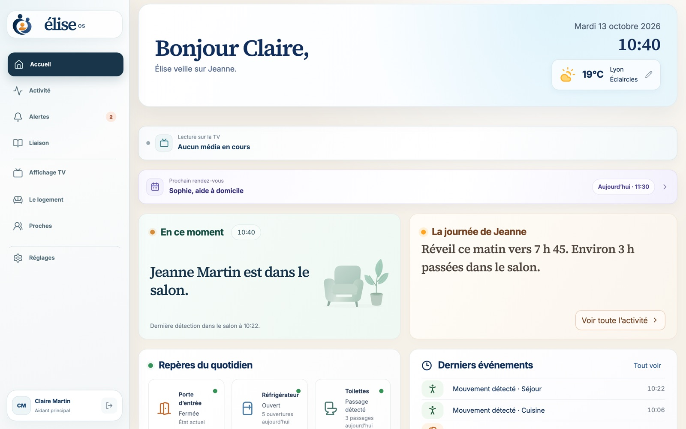

</div>

> [!IMPORTANT]
> Élise OS es un producto de bienestar. **No es un dispositivo médico ni un servicio de emergencia**, y no sustituye a un acompañamiento profesional. Un estado «Todo va bien» significa que Élise dispone de una cobertura suficiente y no ha detectado ninguna anomalía, nunca una garantía de seguridad. En caso de emergencia, llame al 112.

---

## Índice

- [¿Por qué Élise?](#por-qué-élise)
- [Capturas de pantalla](#capturas-de-pantalla)
- [Funcionalidades](#funcionalidades)
- [Cómo funciona](#cómo-funciona)
- [Garantías de seguridad](#garantías-de-seguridad)
- [Privacidad](#privacidad)
- [Hardware](#hardware)
- [Instalación](#instalación)
- [Acceso remoto y aplicación móvil](#acceso-remoto-y-aplicación-móvil)
- [Desarrollo](#desarrollo)
- [Estructura del repositorio](#estructura-del-repositorio)
- [Pila tecnológica](#pila-tecnológica)
- [Documentación](#documentación)
- [Contribuir, seguridad y licencia](#contribuir-seguridad-y-licencia)

---

## ¿Por qué Élise?

Cuando un padre o una madre envejece solo en casa, la familia vive entre dos preocupaciones: no saber, o vigilar demasiado.
Élise propone una tercera vía.

- **Tranquilizar sin grabar.** Unos sensores de movimiento, de apertura, de temperatura o de agua bastan para comprender un día. Las cámaras son opcionales y permanecen aisladas.
- **Comprender en lugar de alarmar.** Élise aprende la rutina del hogar durante 14 días antes de que sus estimaciones se tengan en cuenta, y explica cada alerta con hechos fechados.
- **Mantener el vínculo.** El televisor se convierte en una pantalla familiar: mensajes, fotos, citas del día y videollamadas que se descuelgan con suavidad.
- **Quedarse en casa, en sentido literal.** Todo funciona en un equipo instalado en casa (Raspberry Pi o servidor Ubuntu). El acceso remoto pasa por la red privada Tailscale de la familia, sin exposición a Internet.

El proyecto está dedicado a Élise.

---

## Capturas de pantalla

Capturas tomadas de la [demostración pública](https://eliseos.paulbreton.dev/demo/?lang=es): la «Casa Martin», un hogar ficticio detenido el martes 13 de octubre de 2026 a las 10:40. Claire, la hija, cuida de su madre Jeanne. Las pantallas siguientes muestran la interfaz en francés.

### Espacio del cuidador

|                                                                                                                        |                                                                                                                                                  |
| :--------------------------------------------------------------------------------------------------------------------: | :----------------------------------------------------------------------------------------------------------------------------------------------: |
|                                                                      |                                              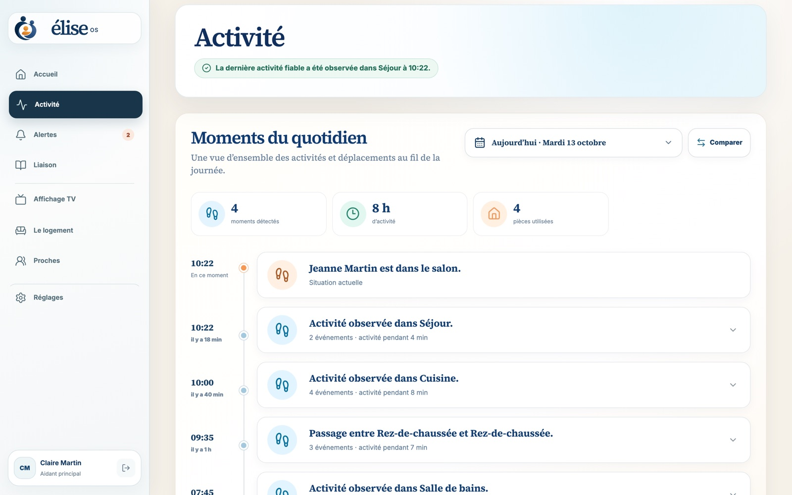                                              |
|     **Inicio** — dónde se encuentra Jeanne, el resumen de su día, las referencias del día a día y la próxima cita.     |                              **Actividad** — la cronología de los desplazamientos y eventos, estancia por estancia.                              |
|                                  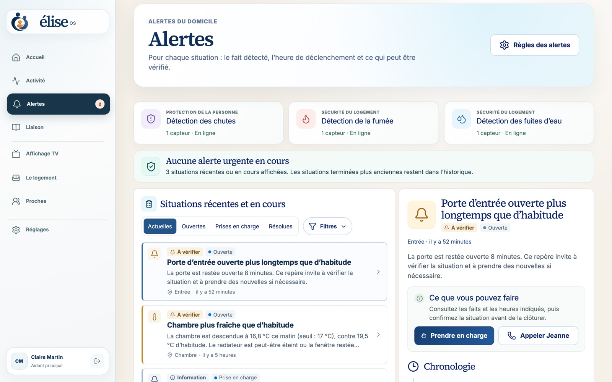                                   |                                       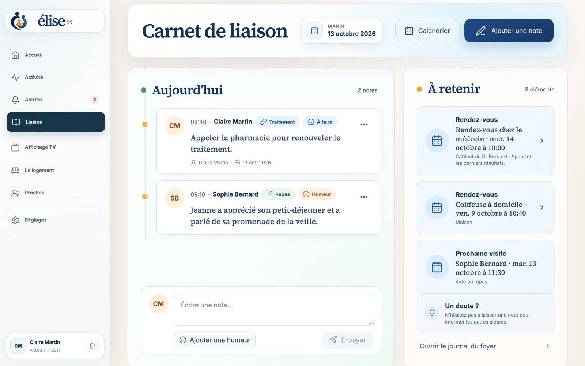                                        |
| **Alertas** — cada situación con el hecho detectado, la hora y lo que se puede comprobar; se atiende con un solo clic. | **Cuaderno de seguimiento** — las notas compartidas entre cuidadores (comidas, estado de ánimo, tratamiento) y las citas que no hay que olvidar. |
|                                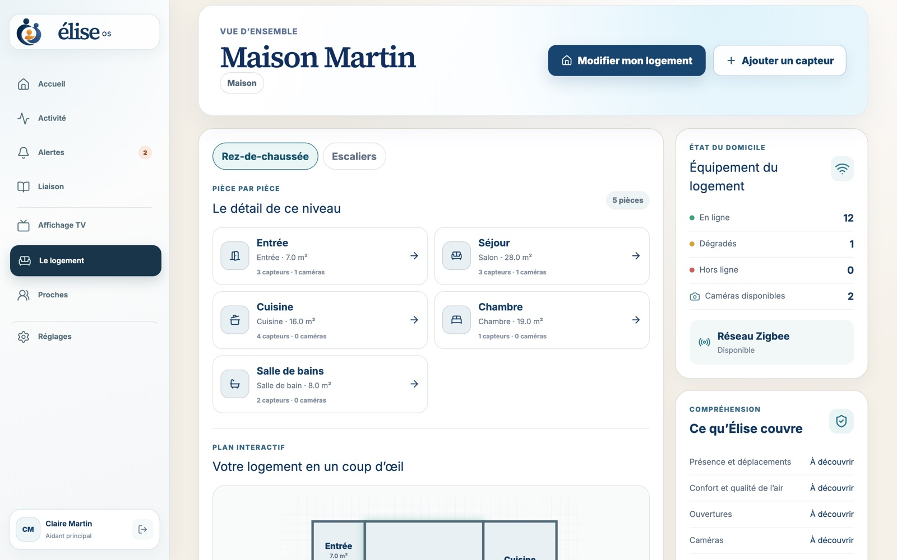                                |                                              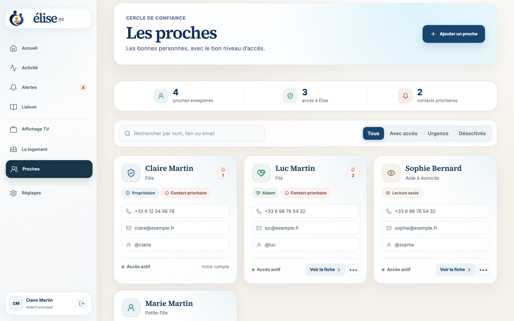                                              |
|     **La vivienda** — estancias, plano interactivo, estado de los sensores y de la red Zigbee, cobertura por uso.      |                                   **Familiares** — el residente, los cuidadores, sus funciones y sus permisos.                                   |
|                              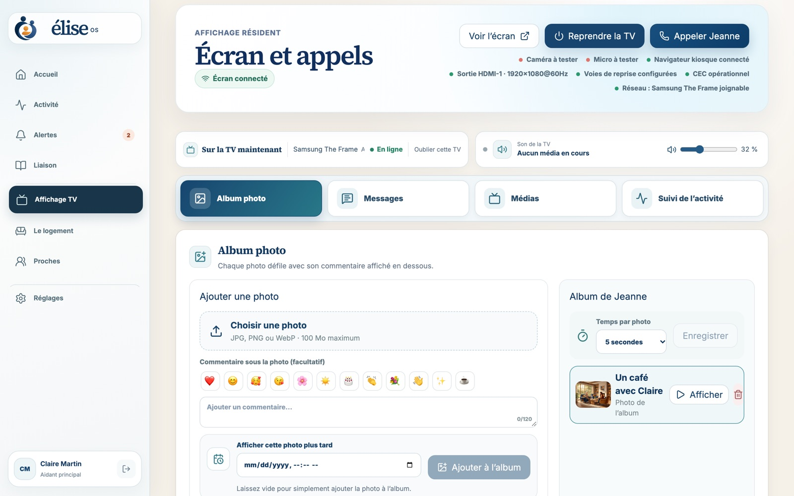                              |                                               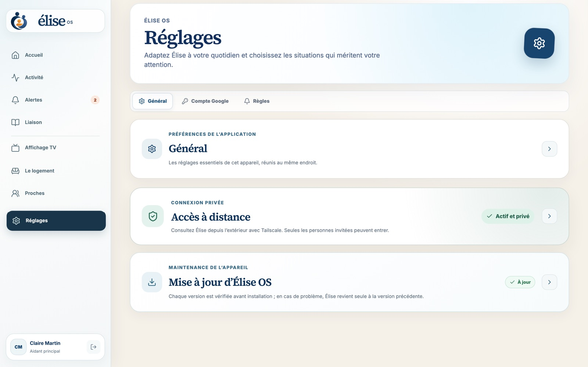                                               |
|          **Pantalla TV** — mensajes, fotos, vídeos, programación y llamadas enviados a la pantalla del salón.          |                                   **Ajustes** — actualizaciones, acceso remoto, cuentas, copias de seguridad.                                    |

### Televisor del residente

<div align="center">
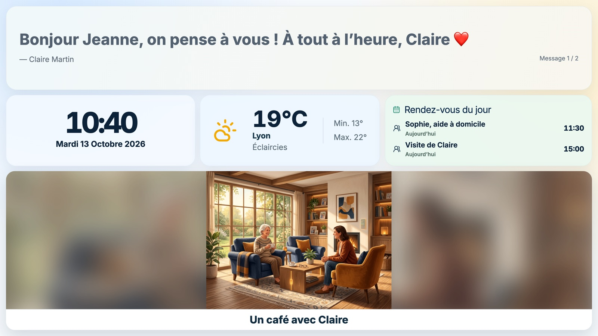
</div>

Una pantalla tranquila, legible a distancia: mensaje del día, hora, tiempo, citas y álbum de fotos. Las videollamadas (Jitsi, autoalojado) se anuncian con una melodía progresiva y se descuelgan con un simple botón.

### En el teléfono y en inglés

|                                       Teléfono                                       |                           English                            |
| :----------------------------------------------------------------------------------: | :----------------------------------------------------------: |
| 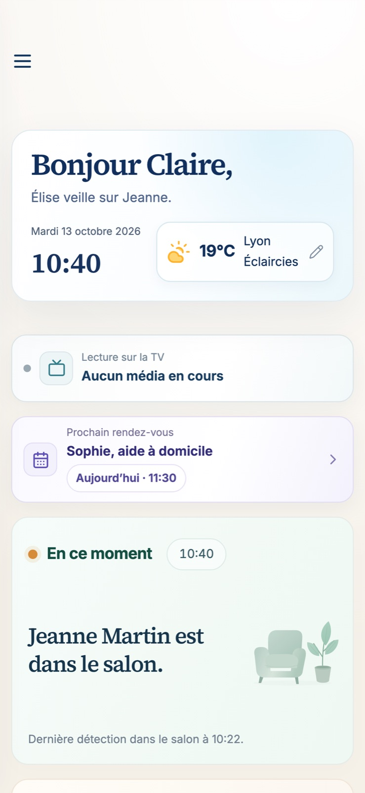 | 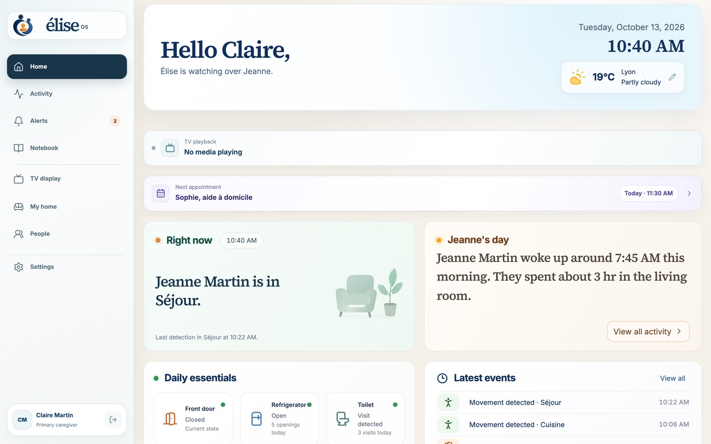 |

La interfaz es totalmente adaptable a cualquier pantalla y está disponible en francés, inglés y español.

---

## Funcionalidades

### Tranquilidad en el día a día

- Ubicación de la última presencia detectada y resumen del día en lenguaje natural.
- Referencias del día a día: levantarse, comidas (frigorífico), aseo, salidas, puerta de entrada.
- Aprendizaje local de los hábitos (Isolation Forest) con un **periodo de aprendizaje protegido de 14 días**.
- Recomendaciones de cobertura: Élise indica qué estancias o qué usos carecen de sensores.

### Alertas explicables

- Detección de caídas, humo, fugas de agua, puerta abierta demasiado tiempo, temperatura anormal, inactividad inusual…
- Reglas de alerta configurables por la familia, ciclo de vida completo (abierta → atendida → resuelta) e historial auditable.
- Una avería de un sensor genera una **alerta de sistema explícita**, nunca una falsa conclusión de inactividad.
- Notificaciones push con un contenido mínimo; los detalles permanecen tras la API autenticada.

### Coordinación de los cuidadores

- Cuaderno de seguimiento compartido, calendario de visitas y citas, seguimiento de los tratamientos.
- Funciones: propietario, administrador, cuidador; invitación de cuidadores mediante el acceso privado Tailscale.

### Pantalla de la TV y llamadas

- Interfaz del residente a pantalla completa por HDMI/DisplayPort (Chromium en modo quiosco).
- Hasta 20 mensajes en rotación, fotos, audio, vídeos, enlaces de YouTube y flujos HTTPS.
- Videollamadas Jitsi autoalojadas, descuelgue automático opcional, botón USB para aceptar o colgar.
- Encendido automático del televisor por HDMI-CEC, Wake-on-LAN o, como alternativa, Home Assistant.

### Casa y compatibilidad

- **Cualquier dispositivo expuesto a Home Assistant**: Zigbee (Zigbee2MQTT), Z-Wave, Matter, Wi-Fi, Bluetooth…
- Detección automática del adaptador Zigbee (Silicon Labs, Texas Instruments, ZiGate, deCONZ, ZBOSS).
- Las entidades desconocidas son visibles y pueden asociarse a una capacidad acotada (`ON_OFF`, `OPEN_CLOSED`, `NUMERIC`, `EVENT_ACTION`), sin código específico para cada modelo.
- Plano interactivo de la vivienda con plantas, estancias y equipos.

### Cámaras (opcionales)

- Cámaras locales RTSP / ONVIF a través de go2rtc, visualización WebRTC en una sesión firmada de 5 minutos.
- Modo privacidad, interfono de pulsar para hablar, imágenes de alerta conservadas 24 h.
- Consentimiento explícito obligatorio para dormitorios y baños.

### Explotación

- Imagen de Raspberry Pi lista para grabar, instalador de Ubuntu en un solo comando, imágenes de contenedores ARM64/AMD64.
- Actualizaciones señaladas con una insignia, instaladas tras confirmación, con **vuelta atrás automática** si falla la comprobación de estado.
- Secretos generados automáticamente, copias de seguridad cifradas (`age`), conservación de datos automática.

---

## Cómo funciona

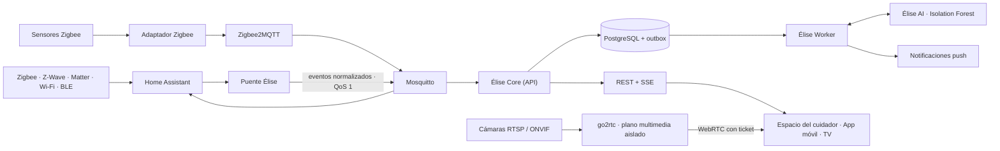

1. **Los sensores** envían sus datos a través de Home Assistant, que actúa como capa de compatibilidad universal.
2. **El puente Élise** traduce las entidades de Home Assistant en _capacidades_ (presencia, apertura, temperatura…) y publica por MQTT eventos normalizados, inmutables e idempotentes.
3. **Élise Core** (NestJS + Prisma) guarda las observaciones en PostgreSQL y aplica las reglas. Una _outbox transaccional_ permite recuperar las tareas diferidas.
4. **Élise Worker** procesa la outbox: aprendizaje, notificaciones, webhooks.
5. **Élise AI** (FastAPI + scikit-learn) evalúa las desviaciones respecto a la rutina. Nunca lee el bus doméstico ni crea alertas: solo Core decide, tras un filtro de confianza y de persistencia.
6. **Las interfaces** (panel React, app Expo, pantalla de la TV) consumen la API REST y los flujos SSE en tiempo real.

Home Assistant, Zigbee2MQTT y Mosquitto son motores internos: nunca aparecen en la experiencia de la familia. Las decisiones de arquitectura se recogen en [`docs/adr`](docs/adr).

---

## Garantías de seguridad

Élise está diseñada en torno a invariantes comprobados por las pruebas:

1. Una avería de un sensor genera una alerta de sistema explícita, nunca una afirmación de inactividad.
2. Un resultado de aprendizaje automático exige confianza, persistencia y validación por parte de Core.
3. Al principio, solo cuentan las reglas confirmadas por la familia; el aprendizaje sigue siendo informativo durante al menos 14 días completos.
4. Un evento repetido no puede crear ni observaciones duplicadas ni alertas SOS duplicadas.
5. Los cambios de una alerta son transiciones que solo se añaden y pueden auditarse.
6. Una capacidad desconocida de Home Assistant es visible, pero no entra en ninguna alerta hasta que se asocie.
7. Las notificaciones push solo contienen un estado genérico y un identificador.
8. Una detección negativa de una cámara nunca demuestra una ausencia.
9. Las credenciales, los flujos, las imágenes y el audio de las cámaras nunca entran en las observaciones, la IA, las notificaciones ni los registros.
10. El acceso a las cámaras está autenticado y auditado; el micrófono solo funciona en modo pulsar para hablar.

---

## Privacidad

Todo el procesamiento es **local**. No se necesita ningún servicio en la nube para funcionar.

| Dato                                     | Plazo de conservación                          |
| ---------------------------------------- | ---------------------------------------------- |
| Observaciones detalladas de los sensores | 90 días                                        |
| Tareas de entrega y datos técnicos       | 30 días                                        |
| Resúmenes del diario                     | hasta 2 años (por defecto)                     |
| Cuentas y registro de auditoría          | hasta que se elimine la cuenta o el hogar      |
| Imágenes de alerta de las cámaras        | 24 horas, excluidas de las copias de seguridad |
| Videollamadas y audio                    | nunca se graban                                |

Detalles: [docs/privacy.md](docs/privacy.md) (en inglés). Esta política favorece la protección de datos desde el diseño, pero no constituye ni un asesoramiento jurídico ni una certificación RGPD.

---

## Hardware

| Elemento       | Recomendación                                                                                                        |
| -------------- | -------------------------------------------------------------------------------------------------------------------- |
| Equipo         | **Raspberry Pi 4 con 8 GB de RAM** (recomendada), o Pi 5 de 8 GB, **o** servidor Ubuntu 24.04 AMD64 / ARM64 con 8 GB |
| Almacenamiento | 32 GB como mínimo; se recomienda un SSD USB o NVMe (Pi 5)                                                            |
| Radio          | Adaptador Zigbee USB (Sonoff, SMLIGHT, ConBee, ZiGate…) — opcional                                                   |
| Sensores       | Movimiento, apertura, temperatura/humedad, fuga de agua, humo, enchufe conectado, botón SOS…                         |
| Pantalla       | Cualquier televisor por HDMI o DisplayPort; webcam USB con micrófono para las llamadas en ambos sentidos             |
| Cámaras        | Opcionales: cualquier cámara local RTSP / ONVIF                                                                      |

Hay una lista de compra orientativa en [docs/liste-achat-domadoo.md](docs/liste-achat-domadoo.md) (en francés).

---

## Instalación

### Raspberry Pi 4 / 5 (recomendado)

1. Instale [Raspberry Pi Imager](https://www.raspberrypi.com/software/).
2. Elija **Usar personalizado** y la imagen `elise-os-…img.xz` de la [última versión](https://github.com/Elise-OS/EliseOS/releases/latest).
3. En los ajustes de Imager, indique el nombre `elise`, su red Wi-Fi, el país y la zona horaria.
4. Escriba la imagen, inserte el almacenamiento y encienda la Raspberry Pi.
5. Abra **http://elise.local** (o la app Élise en la misma red Wi-Fi): la página «Preparación de Élise» sigue la instalación y después abre el asistente de creación de la cuenta de administrador.
6. Vincule Tailscale desde el asistente: el televisor, Chromium, Jitsi y los permisos de cámara y micrófono se configuran automáticamente.

El adaptador Zigbee puede conectarse antes o después: Élise lo detecta y elige el controlador adecuado.

### Ubuntu Server 24.04

```bash
curl -fsSL https://github.com/Elise-OS/EliseOS/releases/latest/download/install-elise.sh | sudo bash
```

El instalador comprueba la máquina, instala Docker, Tailscale y Avahi, verifica el manifiesto firmado de la versión, descarga las imágenes para su arquitectura y espera a que todos los servicios estén en buen estado. Una instalación existente, sus secretos y sus datos se conservan.

### Comandos de administración

```bash
elise status      # estado de los servicios
elise logs        # registros
elise update      # actualización (con vuelta atrás automática)
elise backup      # copia de seguridad cifrada
elise restore /var/lib/elise/backups/elise-AAAA.tar.age --confirm
elise uninstall   # conserva los datos; --purge para eliminarlo todo
```

Cada versión publica la imagen lista para grabar, sus sumas de comprobación y firmas, el catálogo de Raspberry Pi Imager, el instalador, el APK de Android y un manifiesto de contenedores fijados por huella. Guía completa: [docs/installation.md](docs/installation.md) (en francés).

---

## Acceso remoto y aplicación móvil

**Acceso remoto.** Élise nunca se publica en Internet. La familia accede al equipo a través de su red privada [Tailscale](https://tailscale.com), en un puerto dedicado en HTTPS. Se activa en cuatro pasos desde los Ajustes; consulte [docs/acces-distant-prive.md](docs/acces-distant-prive.md) (en francés).

**Aplicación móvil «Élise OS – Companion».** Disponible para **iPhone y iPad (App Store)** y **Android** (APK publicado con cada versión). Encuentra automáticamente el equipo en la red local (`_elise._tcp.local`), verifica su identidad, recibe las notificaciones push y permite hacer una videollamada al residente o enviar fotos al televisor.

---

## Desarrollo

### Requisitos previos

- Docker Engine 23+ con Docker Compose
- Node.js 22 a 26 y pnpm 11
- Python 3.12+ (servicio de IA)

### Iniciar la pila completa

```bash
cp .env.example .env
docker compose up -d
```

Sin hardware Zigbee, inicie solo el núcleo:

```bash
docker compose up -d bootstrap postgres mosquitto ai api worker dashboard
```

Abra **http://localhost:8080**. En una instalación nueva, un asistente local en tres pasos crea la primera cuenta de administrador (accesible únicamente desde la red local). Los secretos de PostgreSQL, MQTT, IA y sesión se generan en el primer arranque, en un volumen Docker privado.

> `ELISE_DEMO_MODE=true` activa una cuenta de demostración V0 (`paul@elise.local` / `Elise-Demo-2026!`), reservada al desarrollo.

En Raspberry Pi, active el descubrimiento móvil con la capa adicional dedicada:

```bash
docker compose -f compose.yaml -f compose.raspberry.yaml up -d
```

Para detectar el adaptador Zigbee y escribir su configuración:

```bash
pnpm zigbee:detect
```

### Trabajar en el código

```bash
pnpm install
pnpm db:generate
pnpm dev          # todas las apps en paralelo
pnpm lint
pnpm typecheck
pnpm test
pnpm build
```

### Demostración sin conexión

El espacio del cuidador incluye un modo de demostración completo, sin servidor ni red (API simulada en memoria, reloj detenido):

```bash
pnpm --filter @elise/dashboard exec vite --mode demo
```

El escenario se encuentra en `apps/dashboard/src/demo/`. `bash scripts/build-landing-demo.sh` publica esta demo en el sitio `eliselanding`.

### Desarrollar en un Mac, probar en un NAS

Docker no es necesario en el Mac: el código se sincroniza y se compila en un NAS al que se accede por Tailscale.

```bash
cp config/nas-deploy.env.example config/nas-deploy.env
pnpm deploy:nas               # recompila ai, api, worker y dashboard
pnpm deploy:nas --dashboard   # vía rápida para un cambio visual
pnpm deploy:nas --dry-run     # vista previa sin modificar nada
bash scripts/dev-dashboard.sh # Vite en local, API en el NAS
```

El despliegue conserva el `.env`, los volúmenes, los secretos y las copias de seguridad del NAS. Consulte [README-NAS.md](README-NAS.md) (en francés).

### Imagen de Raspberry Pi

```bash
pnpm pi:image   # compila la imagen
pnpm pi:flash   # escribe la última imagen compilada en una tarjeta
```

### Integración continua

Cada push ejecuta `format:check`, `lint`, `typecheck`, `test` y `build` en todo el monorepo, `ruff` y `pytest` en el servicio de IA, las pruebas de distribución y la validación de `compose.yaml`. Las versiones se publican con [`release.yml`](.github/workflows/release.yml); el APK de Android, con [`mobile-android-build.yml`](.github/workflows/mobile-android-build.yml).

---

## Estructura del repositorio

```text
.
├── apps/
│   ├── api/          Élise Core — NestJS, Prisma, REST + SSE (alertas, sensores, hogar, cámaras, pantalla…)
│   ├── worker/       Procesamiento de la outbox, notificaciones, tareas diferidas
│   ├── ai/           Servicio Python FastAPI de detección de anomalías explicable
│   ├── dashboard/    Espacio del cuidador y pantalla de la TV — React 19, Vite, Tailwind (+ modo demo)
│   └── mobile/       Aplicación Expo / React Native para iOS y Android
├── packages/
│   ├── contracts/    Esquemas y tipos compartidos entre la API y los clientes
│   ├── ui/           Componentes React compartidos
│   ├── mqtt/         Cliente MQTT y temas normalizados
│   ├── ai-client/    Cliente tipado del servicio de IA
│   ├── config/       Carga y validación de la configuración
│   └── shared/       Utilidades comunes
├── appliance/        Imagen de Raspberry Pi: primer arranque, agentes de pantalla, actualización, acceso remoto
├── install/          Instalador de Ubuntu y comando `elise`
├── docker/           Dockerfiles y configuración de los servicios
├── scripts/          Despliegue en NAS, copia de seguridad, detección Zigbee, compilación de la imagen…
├── docs/             Arquitectura, ADR, instalación, privacidad, cámaras, pantalla de la TV
├── eliselanding/     Sitio público (submódulo Astro + Starlight)
└── compose*.yaml     Pila Docker (base, Raspberry Pi, release, mantenimiento)
```

---

## Pila tecnológica

| Ámbito          | Tecnologías                                                                                   |
| --------------- | --------------------------------------------------------------------------------------------- |
| API             | NestJS 11, Prisma 6, PostgreSQL 18, Server-Sent Events                                        |
| Interfaces      | React 19, Vite 7, Tailwind CSS 4                                                              |
| Móvil           | Expo 54, React Native 0.81, Expo Router                                                       |
| IA              | Python 3.12, FastAPI, scikit-learn (Isolation Forest)                                         |
| Domótica        | Home Assistant 2026.7, Zigbee2MQTT 2.13, Mosquitto 2                                          |
| Multimedia      | go2rtc (WebRTC), Jitsi (videollamadas autoalojadas)                                           |
| Infraestructura | Docker Compose, Tailscale, Avahi (mDNS), Ubuntu 24.04                                         |
| Herramientas    | pnpm 11, Turborepo, TypeScript 5.8, Vitest, ESLint, Prettier, Ruff, Pytest, Husky, Commitlint |

---

## Documentación

| Tema                                                  | Enlace                                                          |
| ----------------------------------------------------- | --------------------------------------------------------------- |
| Instalación en Raspberry Pi y Ubuntu (en francés)     | [docs/installation.md](docs/installation.md)                    |
| Acceso remoto privado (en francés)                    | [docs/acces-distant-prive.md](docs/acces-distant-prive.md)      |
| Pantalla del residente y llamadas (en francés)        | [docs/ecran-resident.md](docs/ecran-resident.md)                |
| Arquitectura e invariantes (en inglés)                | [docs/architecture.md](docs/architecture.md)                    |
| Decisiones de arquitectura (ADR)                      | [docs/adr](docs/adr)                                            |
| Desarrollo, secretos, copias de seguridad (en inglés) | [docs/development.md](docs/development.md)                      |
| Privacidad y conservación (en inglés)                 | [docs/privacy.md](docs/privacy.md)                              |
| Cámaras (en inglés)                                   | [docs/cameras.md](docs/cameras.md)                              |
| Despliegue en NAS (en francés)                        | [README-NAS.md](README-NAS.md)                                  |
| Documentación de usuario completa                     | [eliseos.paulbreton.dev/es](https://eliseos.paulbreton.dev/es/) |

---

## Contribuir, seguridad y licencia

- **Contribuir**: lea [CONTRIBUTING.md](CONTRIBUTING.md). Cualquier cambio estructural, de privacidad o de seguridad empieza por un ADR. Los commits siguen [Conventional Commits](https://www.conventionalcommits.org/es/v1.0.0/).
- **Seguridad**: no publique nunca una vulnerabilidad en una issue; siga [SECURITY.md](SECURITY.md).
- **Licencia**: [AGPL-3.0-only](LICENSE). © 2026 colaboradores de Élise OS.

<div align="center">
<sub>Hecho con cariño, para Élise y para todas las familias que cuidan de un ser querido.</sub>

<a href="https://buymeacoffee.com/drsamourai">☕ Élise OS es gratuito y de código abierto: puede apoyar su desarrollo en Buy Me a Coffee.</a>
</div>
