<div align="center">


# Élise OS

**La piattaforma di serenità a domicilio, locale e open source, per le famiglie e i caregiver.**

Élise impara le abitudini di una casa grazie a sensori discreti, segnala ciò che esce dall'ordinario
e collega il familiare anziano alla sua famiglia attraverso il televisore del salotto — senza mai inviare i suoi dati nel cloud.

[](LICENSE)


[](https://buymeacoffee.com/drsamourai)

[🇫🇷 Français](README.md) · [🇬🇧 English](README.en.md) · [🇪🇸 Español](README.es.md) · **🇮🇹 Italiano**

[Demo online](https://eliseos.paulbreton.dev/demo/?lang=it) · [Sito e documentazione](https://eliseos.paulbreton.dev/it/) · [Scarica](https://github.com/Elise-OS/EliseOS/releases/latest) · [☕ Sostieni il progetto](https://buymeacoffee.com/drsamourai)

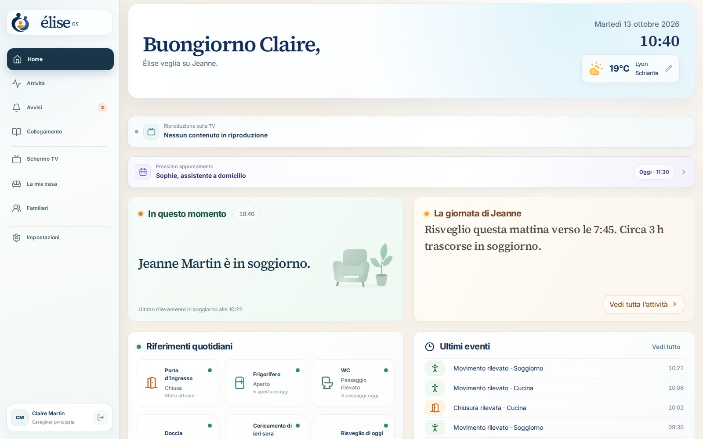

</div>

> [!IMPORTANT]
> Élise OS è un prodotto per il benessere. **Non è un dispositivo medico né un servizio di emergenza** e non sostituisce un accompagnamento professionale. Uno stato «Tutto bene» significa che Élise dispone di una copertura sufficiente e non ha rilevato alcuna anomalia, mai una garanzia di sicurezza. In caso di emergenza, chiami il 112.

---

## Indice

- [Perché Élise?](#perché-élise)
- [Schermate](#schermate)
- [Funzionalità](#funzionalità)
- [Come funziona](#come-funziona)
- [Garanzie di sicurezza](#garanzie-di-sicurezza)
- [Privacy](#privacy)
- [Hardware](#hardware)
- [Installazione](#installazione)
- [Accesso da remoto e app mobile](#accesso-da-remoto-e-app-mobile)
- [Sviluppo](#sviluppo)
- [Struttura del repository](#struttura-del-repository)
- [Stack tecnologico](#stack-tecnologico)
- [Documentazione](#documentazione)
- [Contribuire, sicurezza e licenza](#contribuire-sicurezza-e-licenza)

---

## Perché Élise?

Quando un genitore invecchia da solo in casa, la famiglia vive tra due preoccupazioni: non sapere, oppure controllare troppo.
Élise propone una terza via.

- **Rassicurare senza riprendere.** Dei sensori di movimento, di apertura, di temperatura o di acqua bastano a comprendere una giornata. Le telecamere sono facoltative e restano isolate.
- **Comprendere anziché allarmare.** Élise impara la routine della casa per 14 giorni prima che le sue stime vengano prese in considerazione, e spiega ogni avviso con fatti datati.
- **Mantenere il legame.** Il televisore diventa uno schermo di famiglia: messaggi, foto, appuntamenti del giorno e videochiamate che si avviano con dolcezza.
- **Restare a casa propria, alla lettera.** Tutto funziona su un dispositivo installato in casa (Raspberry Pi o server Ubuntu). L'accesso da remoto passa attraverso la rete privata Tailscale della famiglia, senza alcuna esposizione su Internet.

Il progetto è dedicato a Élise.

---

## Schermate

Schermate tratte dalla [demo pubblica](https://eliseos.paulbreton.dev/demo/?lang=it): la «Casa Martin», una famiglia fittizia ferma a martedì 13 ottobre 2026 alle 10:40. Claire, la figlia, si prende cura della madre Jeanne. Le schermate seguenti mostrano l'interfaccia in francese.

### Area caregiver

|                                                                                                                                 |                                                                                                                     |
| :-----------------------------------------------------------------------------------------------------------------------------: | :-----------------------------------------------------------------------------------------------------------------: |
|                                                                              |                              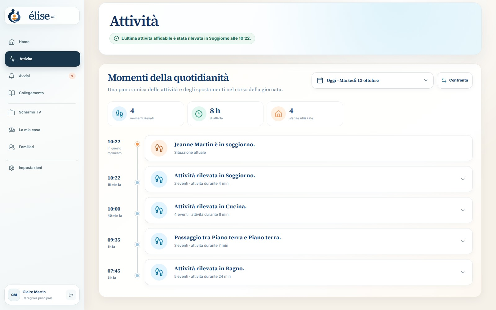                               |
| **Home** — dove si trova Jeanne, il riepilogo della sua giornata, i punti di riferimento quotidiani e il prossimo appuntamento. |                  **Attività** — la cronologia degli spostamenti e degli eventi, stanza per stanza.                  |
|                                      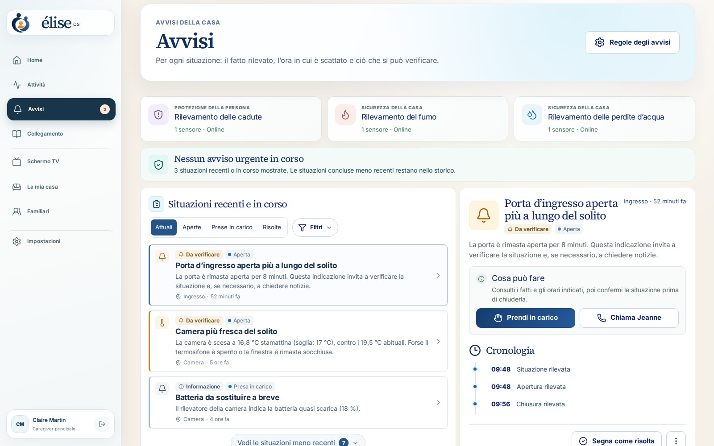                                      |                         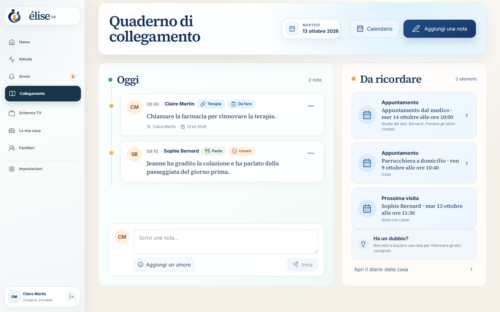                         |
|  **Avvisi** — ogni situazione con il fatto rilevato, l'ora e ciò che si può verificare; si prende in carico con un solo clic.   | **Diario di assistenza** — le note condivise tra caregiver (pasti, umore, terapia) e gli appuntamenti da ricordare. |
|                                  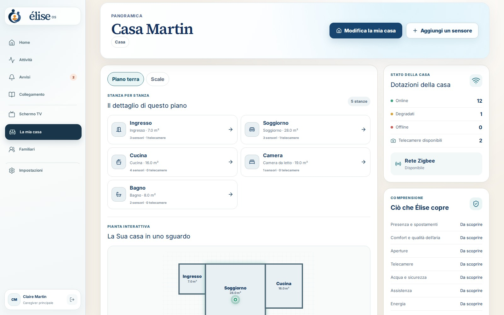                                   |                              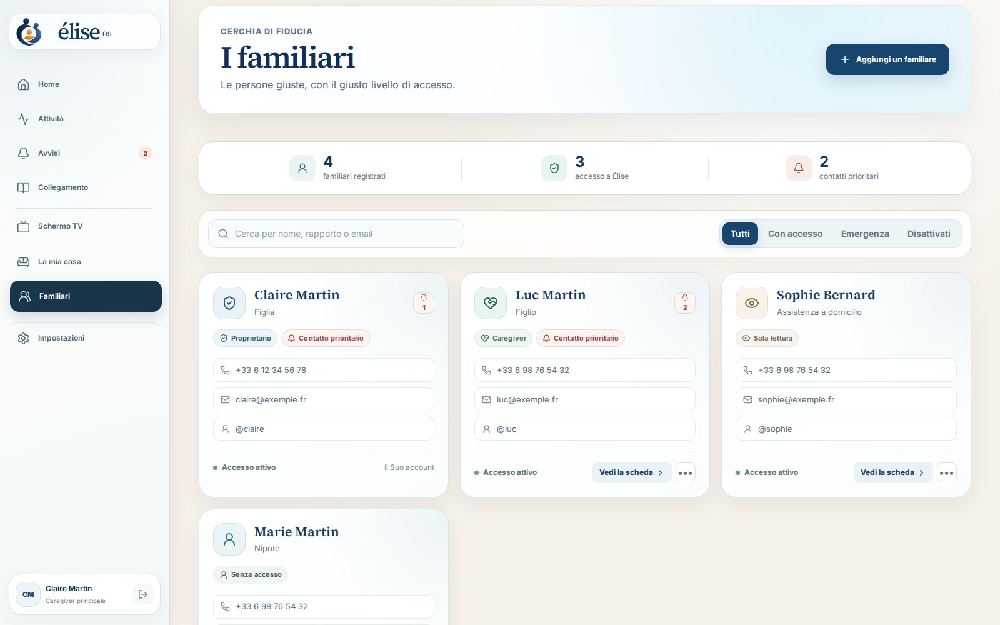                               |
|       **L'abitazione** — stanze, planimetria interattiva, stato dei sensori e della rete Zigbee, copertura per utilizzo.        |                  **Familiari** — il residente, i caregiver, i loro ruoli e le loro autorizzazioni.                  |
|                                 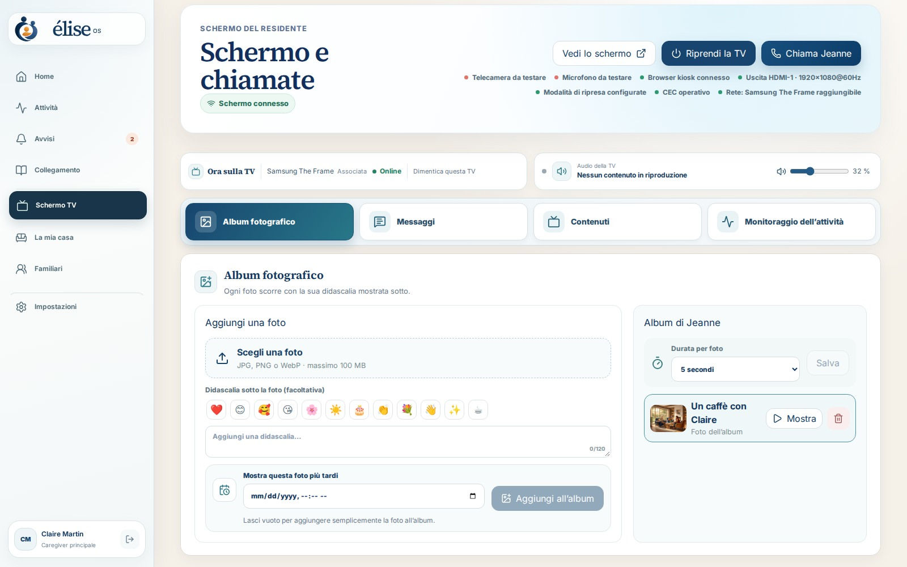                                  |                            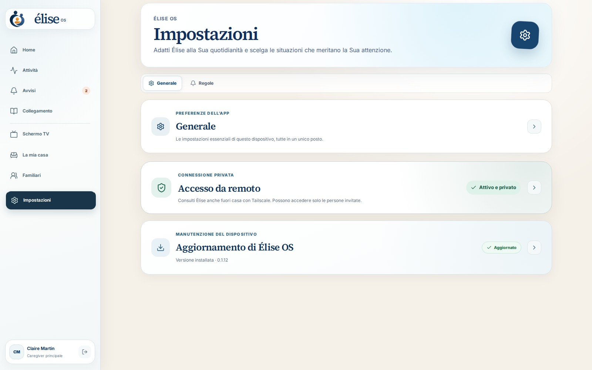                             |
|               **Schermo TV** — messaggi, foto, video, programmazione e chiamate inviati allo schermo del salotto.               |                        **Impostazioni** — aggiornamenti, accesso da remoto, account, backup.                        |

### Televisore del residente

<div align="center">
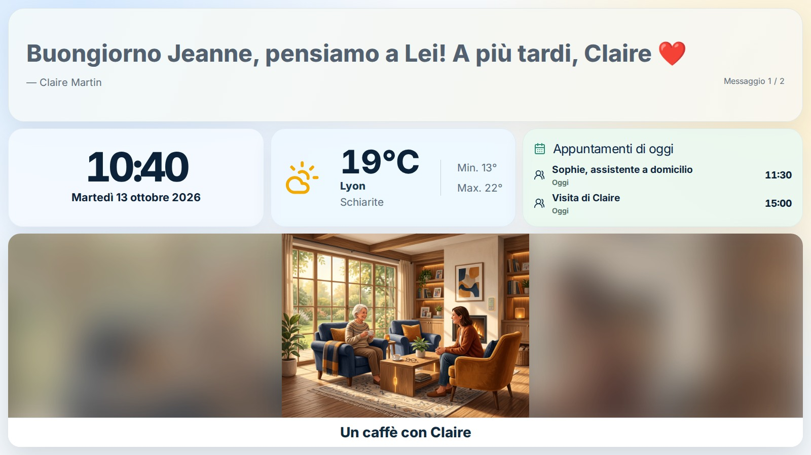
</div>

Uno schermo tranquillo, leggibile da lontano: messaggio del giorno, ora, meteo, appuntamenti e album fotografico. Le videochiamate (Jitsi, self-hosted) si annunciano con una melodia progressiva e si accettano con un semplice pulsante.

### Su smartphone e computer

|                                       Smartphone                                        |                             Computer                             |
| :-------------------------------------------------------------------------------------: | :--------------------------------------------------------------: |
| 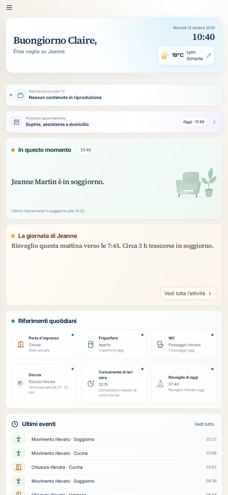 |  |

L'interfaccia è completamente adattabile a qualsiasi schermo ed è disponibile in francese, inglese, spagnolo e italiano.

---

## Funzionalità

### Serenità nella vita quotidiana

- Posizione dell'ultima presenza rilevata e riepilogo della giornata in linguaggio naturale.
- Punti di riferimento quotidiani: risveglio, pasti (frigorifero), bagno, uscite, porta d'ingresso.
- Apprendimento locale delle abitudini (Isolation Forest) con un **periodo di apprendimento protetto di 14 giorni**.
- Raccomandazioni di copertura: Élise indica quali stanze o quali utilizzi non dispongono di sensori.

### Avvisi spiegabili

- Rilevamento di possibili cadute, fumo, perdite d'acqua, porta aperta troppo a lungo, temperatura anomala, inattività insolita…
- Regole di avviso configurabili dalla famiglia, ciclo di vita completo (aperto → preso in carico → risolto) e cronologia verificabile.
- Il guasto di un sensore genera un **avviso di sistema esplicito**, mai una falsa conclusione di inattività.
- Notifiche push con contenuto minimo; i dettagli restano dietro l'API autenticata.

### Coordinamento dei caregiver

- Diario di assistenza condiviso, calendario delle visite e degli appuntamenti, monitoraggio delle terapie.
- Ruoli: proprietario, amministratore, caregiver; invito dei caregiver tramite l'accesso privato Tailscale.

### Schermo TV e chiamate

- Interfaccia del residente a schermo intero tramite HDMI/DisplayPort (Chromium in modalità kiosk).
- Fino a 20 messaggi a rotazione, foto, audio, video, link YouTube e flussi HTTPS.
- Videochiamate Jitsi self-hosted, risposta automatica facoltativa, pulsante USB per accettare o terminare.
- Accensione automatica del televisore tramite HDMI-CEC, Wake-on-LAN o, in alternativa, Home Assistant.

### Casa e compatibilità

- **Qualsiasi dispositivo esposto a Home Assistant**: Zigbee (Zigbee2MQTT), Z-Wave, Matter, Wi-Fi, Bluetooth…
- Rilevamento automatico dell'adattatore Zigbee (Silicon Labs, Texas Instruments, ZiGate, deCONZ, ZBOSS).
- Le entità sconosciute sono visibili e possono essere associate a una capacità circoscritta (`ON_OFF`, `OPEN_CLOSED`, `NUMERIC`, `EVENT_ACTION`), senza codice specifico per ogni modello.
- Planimetria interattiva dell'abitazione con piani, stanze e dispositivi.

### Telecamere (facoltative)

- Telecamere locali RTSP / ONVIF tramite go2rtc, visualizzazione WebRTC in una sessione firmata di 5 minuti.
- Modalità privacy, interfono push-to-talk, immagini di avviso conservate per 24 h.
- Consenso esplicito obbligatorio per camere da letto e bagni.

### Gestione e operatività

- Immagine Raspberry Pi pronta da scrivere, installer Ubuntu con un solo comando, immagini dei container ARM64/AMD64.
- Aggiornamenti segnalati da un badge, installati dopo conferma, con **ripristino automatico** se il controllo di integrità fallisce.
- Segreti generati automaticamente, backup cifrati (`age`), conservazione automatica dei dati.

---

## Come funziona

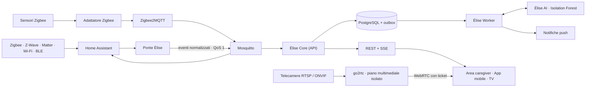

1. **I sensori** inviano i loro dati tramite Home Assistant, che funge da livello di compatibilità universale.
2. **Il ponte Élise** traduce le entità di Home Assistant in _capacità_ (presenza, apertura, temperatura…) e pubblica su MQTT eventi normalizzati, immutabili e idempotenti.
3. **Élise Core** (NestJS + Prisma) salva le osservazioni in PostgreSQL e applica le regole. Una _outbox transazionale_ rende recuperabili le elaborazioni differite.
4. **Élise Worker** elabora l'outbox: apprendimento, notifiche, webhook.
5. **Élise AI** (FastAPI + scikit-learn) valuta gli scostamenti rispetto alla routine. Non legge mai il bus domestico e non crea mai avvisi: decide solo Core, dopo un filtro di affidabilità e di persistenza.
6. **Le interfacce** (dashboard React, app Expo, schermo TV) usano l'API REST e i flussi SSE in tempo reale.

Home Assistant, Zigbee2MQTT e Mosquitto sono motori interni: non compaiono mai nell'esperienza della famiglia. Le decisioni di architettura sono raccolte in [`docs/adr`](docs/adr).

---

## Garanzie di sicurezza

Élise è progettata attorno a invarianti verificati dai test:

1. Il guasto di un sensore genera un avviso di sistema esplicito, mai un'affermazione di inattività.
2. Un risultato dell'apprendimento automatico richiede affidabilità, persistenza e validazione da parte di Core.
3. All'inizio contano solo le regole confermate dalla famiglia; l'apprendimento resta puramente informativo per almeno 14 giorni completi.
4. Un evento ripetuto non può creare né osservazioni duplicate né avvisi SOS duplicati.
5. Le modifiche di un avviso sono transizioni in sola aggiunta e verificabili.
6. Una capacità sconosciuta di Home Assistant è visibile, ma non rientra in alcun avviso finché non viene associata.
7. Le notifiche push contengono solo uno stato generico e un identificatore.
8. Un rilevamento negativo di una telecamera non dimostra mai un'assenza.
9. Credenziali, flussi, immagini e audio delle telecamere non entrano mai nelle osservazioni, nell'IA, nelle notifiche né nei log.
10. L'accesso alle telecamere è autenticato e verificato; il microfono funziona solo in modalità push-to-talk.

---

## Privacy

Tutta l'elaborazione è **locale**. Per funzionare non occorre alcun servizio cloud.

| Dato                                 | Periodo di conservazione                        |
| ------------------------------------ | ----------------------------------------------- |
| Osservazioni dettagliate dei sensori | 90 giorni                                       |
| Attività di consegna e dati tecnici  | 30 giorni                                       |
| Riepiloghi del diario                | fino a 2 anni (per impostazione predefinita)    |
| Account e registro di audit          | fino all'eliminazione dell'account o della casa |
| Immagini di avviso delle telecamere  | 24 ore, escluse dai backup                      |
| Videochiamate e audio                | mai registrati                                  |

Dettagli: [docs/privacy.md](docs/privacy.md) (in inglese). Questa politica favorisce la protezione dei dati fin dalla progettazione, ma non costituisce né una consulenza legale né una certificazione GDPR.

---

## Hardware

| Elemento      | Raccomandazione                                                                                                              |
| ------------- | ---------------------------------------------------------------------------------------------------------------------------- |
| Dispositivo   | **Raspberry Pi 4 con 8 GB di RAM** (consigliato), oppure Pi 5 da 8 GB, **oppure** server Ubuntu 24.04 AMD64 / ARM64 con 8 GB |
| Archiviazione | Almeno 32 GB; si consiglia un SSD USB o NVMe (Pi 5)                                                                          |
| Radio         | Adattatore Zigbee USB (Sonoff, SMLIGHT, ConBee, ZiGate…) — facoltativo                                                       |
| Sensori       | Movimento, apertura, temperatura/umidità, perdita d'acqua, fumo, presa smart, pulsante SOS…                                  |
| Schermo       | Qualsiasi televisore tramite HDMI o DisplayPort; webcam USB con microfono per le chiamate nei due sensi                      |
| Telecamere    | Facoltative: qualsiasi telecamera locale RTSP / ONVIF                                                                        |

Una lista della spesa indicativa è disponibile in [docs/liste-achat-domadoo.md](docs/liste-achat-domadoo.md) (in francese).

---

## Installazione

### Raspberry Pi 4 / 5 (consigliato)

1. Installi [Raspberry Pi Imager](https://www.raspberrypi.com/software/).
2. Scelga **Usa personalizzata** e l'immagine `elise-os-…img.xz` dell'[ultima versione](https://github.com/Elise-OS/EliseOS/releases/latest).
3. Nelle impostazioni di Imager, indichi il nome `elise`, la Sua rete Wi-Fi, il paese e il fuso orario. Per SSH scelga l’autenticazione con chiave pubblica: l’immagine non ha una password predefinita.
4. Scriva l'immagine, inserisca la memoria e avvii il Raspberry Pi.
5. Apra **http://elise.local** (o l'app Élise sulla stessa rete Wi-Fi): la pagina «Preparazione di Élise» segue l'installazione e poi apre la procedura guidata per la creazione dell'account amministratore.
6. Associ Tailscale dalla procedura guidata: il televisore, Chromium, Jitsi e le autorizzazioni per telecamera e microfono si configurano automaticamente.

L'adattatore Zigbee può essere collegato prima o dopo: Élise lo rileva e sceglie il driver adatto.

### Ubuntu Server 24.04

```bash
curl -fsSL https://github.com/Elise-OS/EliseOS/releases/latest/download/install-elise.sh | sudo bash
```

L'installer controlla la macchina, installa Docker, Tailscale e Avahi, verifica il manifesto firmato della versione, scarica le immagini per la Sua architettura e attende che tutti i servizi siano in buono stato. Un'installazione esistente, i suoi segreti e i suoi dati vengono conservati.

### Comandi di amministrazione

```bash
elise status      # stato dei servizi
elise logs        # log
elise update      # aggiornamento (con ripristino automatico)
elise backup      # backup cifrato
elise restore /var/lib/elise/backups/elise-AAAA.tar.age --confirm
elise uninstall   # conserva i dati; --purge per eliminare tutto
```

Ogni versione pubblica l'immagine pronta da scrivere, i suoi checksum e le sue firme, il catalogo di Raspberry Pi Imager, l'installer, l'APK Android e un manifesto di container fissati tramite impronta. Guida completa: [docs/installation.md](docs/installation.md) (in francese).

---

## Accesso da remoto e app mobile

**Accesso da remoto.** Élise non viene mai pubblicata su Internet. La famiglia accede al dispositivo tramite la propria rete privata [Tailscale](https://tailscale.com), su una porta dedicata in HTTPS. Si attiva in quattro passaggi dalle Impostazioni; consulti [docs/acces-distant-prive.md](docs/acces-distant-prive.md) (in francese).

**App mobile «Élise OS – Companion».** Disponibile per **iPhone e iPad (App Store)** e **Android** (APK pubblicato con ogni versione). Trova automaticamente il dispositivo sulla rete locale (`_elise._tcp.local`), ne verifica l'identità, riceve le notifiche push e permette di videochiamare il residente o di inviare foto al televisore.

---

## Sviluppo

### Prerequisiti

- Docker Engine 23+ con Docker Compose
- Node.js da 22 a 26 e pnpm 11
- Python 3.12+ (servizio IA)

### Avviare lo stack completo

```bash
cp .env.example .env
docker compose up -d
```

Senza hardware Zigbee, avvii solo il nucleo:

```bash
docker compose up -d bootstrap postgres mosquitto ai api worker dashboard
```

Apra **http://localhost:8080**. In una nuova installazione, una procedura guidata locale in tre passaggi crea il primo account amministratore (accessibile solo dalla rete locale). I segreti di PostgreSQL, MQTT, IA e di sessione vengono generati al primo avvio, in un volume Docker privato.

> `ELISE_DEMO_MODE=true` attiva un account dimostrativo V0 (`paul@elise.local` / `Elise-Demo-2026!`), riservato allo sviluppo.

Su Raspberry Pi, attivi il rilevamento da mobile con il livello aggiuntivo dedicato:

```bash
docker compose -f compose.yaml -f compose.raspberry.yaml up -d
```

Per rilevare l'adattatore Zigbee e scriverne la configurazione:

```bash
pnpm zigbee:detect
```

### Lavorare sul codice

```bash
pnpm install
pnpm db:generate
pnpm dev          # tutte le app in parallelo
pnpm lint
pnpm typecheck
pnpm test
pnpm build
```

### Demo offline

L'area caregiver include una modalità dimostrativa completa, senza server né rete (API simulata in memoria, orologio fermo):

```bash
pnpm --filter @elise/dashboard exec vite --mode demo
```

Lo scenario si trova in `apps/dashboard/src/demo/`. `bash scripts/build-landing-demo.sh` pubblica questa demo nel sito `eliselanding`.

### Sviluppare su Mac, testare su un NAS

Su Mac non serve Docker: il codice viene sincronizzato e compilato su un NAS raggiunto tramite Tailscale.

```bash
cp config/nas-deploy.env.example config/nas-deploy.env
pnpm deploy:nas               # ricompila ai, api, worker e dashboard
pnpm deploy:nas --dashboard   # via rapida per una modifica visiva
pnpm deploy:nas --dry-run     # anteprima senza modificare nulla
bash scripts/dev-dashboard.sh # Vite in locale, API sul NAS
```

Il deploy conserva il `.env`, i volumi, i segreti e i backup del NAS. Consulti [README-NAS.md](README-NAS.md) (in francese).

### Immagine Raspberry Pi

```bash
pnpm pi:image   # compila l'immagine
pnpm pi:flash   # scrive l'ultima immagine compilata su una scheda
```

### Integrazione continua

Ogni push esegue `format:check`, `lint`, `typecheck`, `test` e `build` sull'intero monorepo, `ruff` e `pytest` sul servizio IA, i test di distribuzione e la validazione di `compose.yaml`. Le versioni vengono pubblicate da [`release.yml`](.github/workflows/release.yml); l'APK Android, da [`mobile-android-build.yml`](.github/workflows/mobile-android-build.yml).

---

## Struttura del repository

```text
.
├── apps/
│   ├── api/          Élise Core — NestJS, Prisma, REST + SSE (avvisi, sensori, casa, telecamere, schermo…)
│   ├── worker/       Elaborazione dell'outbox, notifiche, attività differite
│   ├── ai/           Servizio Python FastAPI di rilevamento di anomalie spiegabile
│   ├── dashboard/    Area caregiver e schermo TV — React 19, Vite, Tailwind (+ modalità demo)
│   └── mobile/       Applicazione Expo / React Native per iOS e Android
├── packages/
│   ├── contracts/    Schemi e tipi condivisi tra API e client
│   ├── ui/           Componenti React condivisi
│   ├── mqtt/         Client MQTT e topic normalizzati
│   ├── ai-client/    Client tipizzato del servizio IA
│   ├── config/       Caricamento e validazione della configurazione
│   └── shared/       Utilità comuni
├── appliance/        Immagine Raspberry Pi: primo avvio, agenti dello schermo, aggiornamento, accesso da remoto
├── install/          Installer Ubuntu e comando `elise`
├── docker/           Dockerfile e configurazione dei servizi
├── scripts/          Deploy su NAS, backup, rilevamento Zigbee, build dell'immagine…
├── docs/             Architettura, ADR, installazione, privacy, telecamere, schermo TV
├── eliselanding/     Sito pubblico (sottomodulo Astro + Starlight)
└── compose*.yaml     Stack Docker (base, Raspberry Pi, release, manutenzione)
```

---

## Stack tecnologico

| Ambito         | Tecnologie                                                                                    |
| -------------- | --------------------------------------------------------------------------------------------- |
| API            | NestJS 11, Prisma 6, PostgreSQL 18, Server-Sent Events                                        |
| Interfacce     | React 19, Vite 7, Tailwind CSS 4                                                              |
| Mobile         | Expo 54, React Native 0.81, Expo Router                                                       |
| IA             | Python 3.12, FastAPI, scikit-learn (Isolation Forest)                                         |
| Domotica       | Home Assistant 2026.7, Zigbee2MQTT 2.13, Mosquitto 2                                          |
| Multimedia     | go2rtc (WebRTC), Jitsi (videochiamate self-hosted)                                            |
| Infrastruttura | Docker Compose, Tailscale, Avahi (mDNS), Ubuntu 24.04                                         |
| Strumenti      | pnpm 11, Turborepo, TypeScript 5.8, Vitest, ESLint, Prettier, Ruff, Pytest, Husky, Commitlint |

---

## Documentazione

| Argomento                                            | Link                                                            |
| ---------------------------------------------------- | --------------------------------------------------------------- |
| Installazione su Raspberry Pi e Ubuntu (in francese) | [docs/installation.md](docs/installation.md)                    |
| Accesso da remoto privato (in francese)              | [docs/acces-distant-prive.md](docs/acces-distant-prive.md)      |
| Schermo del residente e chiamate (in francese)       | [docs/ecran-resident.md](docs/ecran-resident.md)                |
| Architettura e invarianti (in inglese)               | [docs/architecture.md](docs/architecture.md)                    |
| Decisioni di architettura (ADR)                      | [docs/adr](docs/adr)                                            |
| Sviluppo, segreti, backup (in inglese)               | [docs/development.md](docs/development.md)                      |
| Privacy e conservazione (in inglese)                 | [docs/privacy.md](docs/privacy.md)                              |
| Telecamere (in inglese)                              | [docs/cameras.md](docs/cameras.md)                              |
| Deploy su NAS (in francese)                          | [README-NAS.md](README-NAS.md)                                  |
| Documentazione utente completa                       | [eliseos.paulbreton.dev/it](https://eliseos.paulbreton.dev/it/) |

---

## Contribuire, sicurezza e licenza

- **Contribuire**: legga [CONTRIBUTING.md](CONTRIBUTING.md). Qualsiasi modifica strutturale, di privacy o di sicurezza inizia con un ADR. I commit seguono [Conventional Commits](https://www.conventionalcommits.org/).
- **Sicurezza**: non pubblichi mai una vulnerabilità in una issue; segua [SECURITY.md](SECURITY.md).
- **Licenza**: [AGPL-3.0-only](LICENSE). © 2026 collaboratori di Élise OS.

<div align="center">
<sub>Fatto con cura, per Élise e per tutte le famiglie che si prendono cura di una persona cara.</sub>

<a href="https://buymeacoffee.com/drsamourai">☕ Élise OS è gratuito e open source: può sostenerne lo sviluppo su Buy Me a Coffee.</a>
</div>
