<div align="center">


# Élise OS

**La plateforme de réassurance à domicile, locale et open source, pour les familles et les aidants.**

Élise apprend les habitudes d’une maison grâce à des capteurs discrets, signale ce qui sort de l’ordinaire
et relie le proche âgé à sa famille par la télévision du salon — sans jamais envoyer ses données dans le cloud.

[](LICENSE)


[](https://buymeacoffee.com/drsamourai)

**🇫🇷 Français** · [🇬🇧 English](README.en.md) · [🇪🇸 Español](README.es.md) · [🇮🇹 Italiano](README.it.md) · [🇵🇹 Português](README.pt.md)

[Démo en ligne](https://eliseos.paulbreton.dev/demo/) · [Site et documentation](https://eliseos.paulbreton.dev) · [Télécharger](https://github.com/Elise-OS/EliseOS/releases/latest) · [☕ Soutenir le projet](https://buymeacoffee.com/drsamourai)

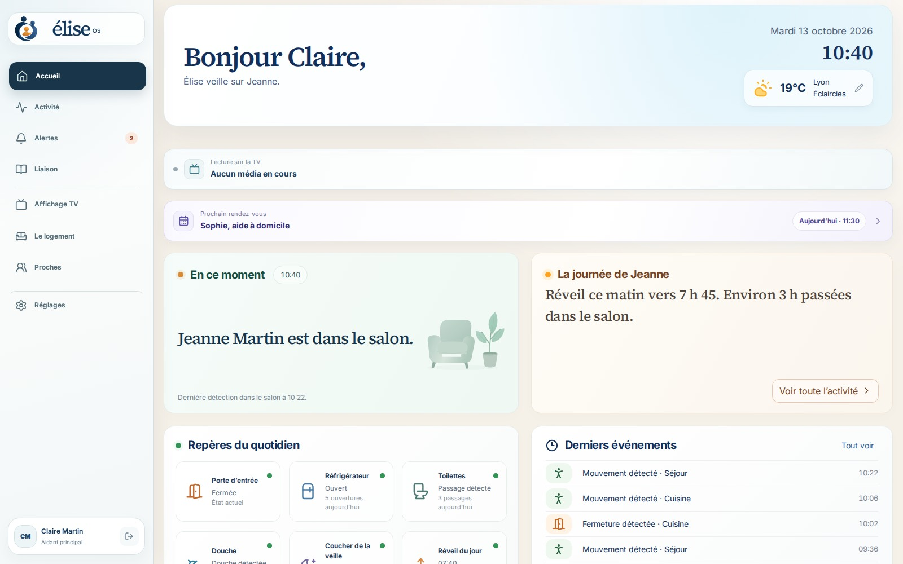

</div>

> [!IMPORTANT]
> Élise OS est un produit de bien-être. Ce n’est **ni un dispositif médical, ni un service d’urgence**, et il ne remplace pas un accompagnement professionnel. Un statut « tout va bien » signifie qu’Élise dispose d’une couverture suffisante et n’a pas détecté d’anomalie, jamais une garantie de sécurité.

---

## Sommaire

- [Pourquoi Élise ?](#pourquoi-élise-)
- [Aperçu en images](#aperçu-en-images)
- [Fonctionnalités](#fonctionnalités)
- [Comment ça marche](#comment-ça-marche)
- [Garanties de sécurité](#garanties-de-sécurité)
- [Vie privée](#vie-privée)
- [Matériel](#matériel)
- [Installation](#installation)
- [Accès à distance et application mobile](#accès-à-distance-et-application-mobile)
- [Développement](#développement)
- [Structure du dépôt](#structure-du-dépôt)
- [Pile technique](#pile-technique)
- [Documentation](#documentation)
- [Contribuer, sécurité et licence](#contribuer-sécurité-et-licence)

---

## Pourquoi Élise ?

Quand un parent vieillit seul chez lui, la famille vit entre deux inquiétudes : ne pas savoir, ou trop surveiller.
Élise propose une troisième voie.

- **Rassurer sans filmer.** Des capteurs de mouvement, d’ouverture, de température ou d’eau suffisent à comprendre une journée. Les caméras restent facultatives et isolées.
- **Comprendre plutôt qu’alerter.** Élise apprend la routine du foyer pendant 14 jours avant que ses estimations ne comptent, et explique chaque alerte par des faits datés.
- **Garder le lien.** La télévision devient un écran familial : messages, photos, rendez-vous du jour et appels vidéo qui décrochent en douceur.
- **Rester chez soi, au sens propre.** Tout tourne sur un boîtier à la maison (Raspberry Pi ou serveur Ubuntu). L’accès à distance passe par le réseau privé Tailscale de la famille, sans exposition sur Internet.

Le projet est dédié à Élise.

---

## Aperçu en images

Captures issues de la [démonstration publique](https://eliseos.paulbreton.dev/demo/) : la « Maison Martin », un foyer fictif figé au mardi 13 octobre 2026 à 10 h 40. Claire, la fille, veille sur sa mère Jeanne.

### Espace aidant

|                                                                                                                        |                                                                                                                     |
| :--------------------------------------------------------------------------------------------------------------------: | :-----------------------------------------------------------------------------------------------------------------: |
|                                                                  |                              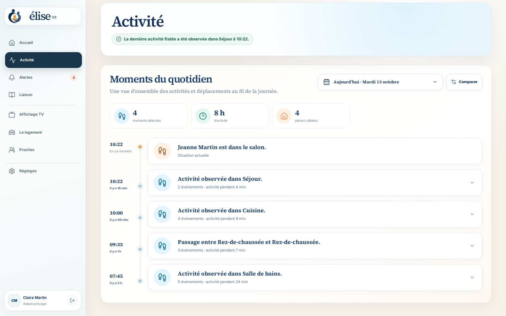                               |
|    **Accueil** — où se trouve Jeanne, le résumé de sa journée, les repères du quotidien et le prochain rendez-vous.    |                   **Activité** — la chronologie des déplacements et événements, pièce par pièce.                    |
|                                 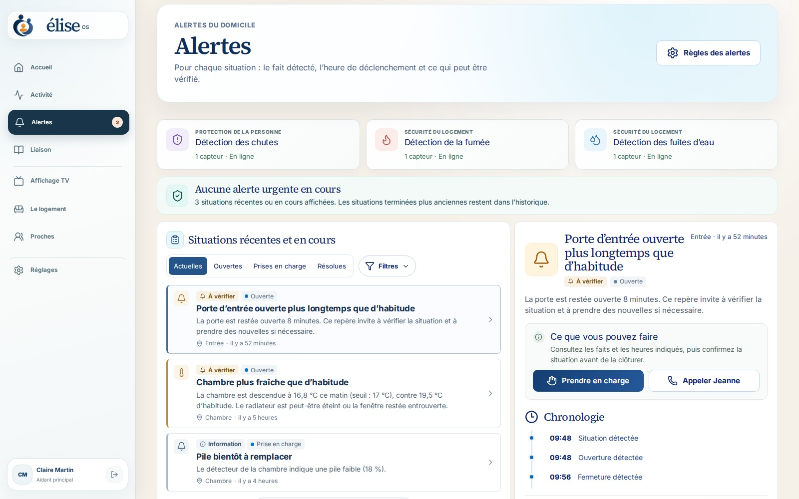                                 |                          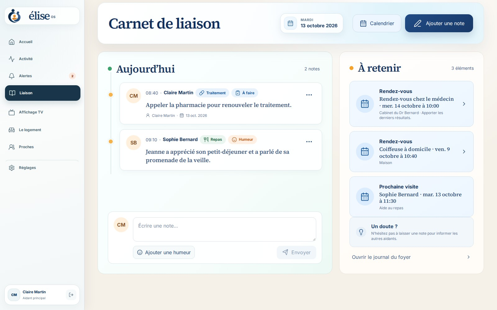                           |
| **Alertes** — chaque situation avec le fait détecté, l’heure et ce qui peut être vérifié ; prise en charge en un clic. | **Carnet de liaison** — les notes partagées entre aidants (repas, humeur, traitement) et les rendez-vous à retenir. |
|                              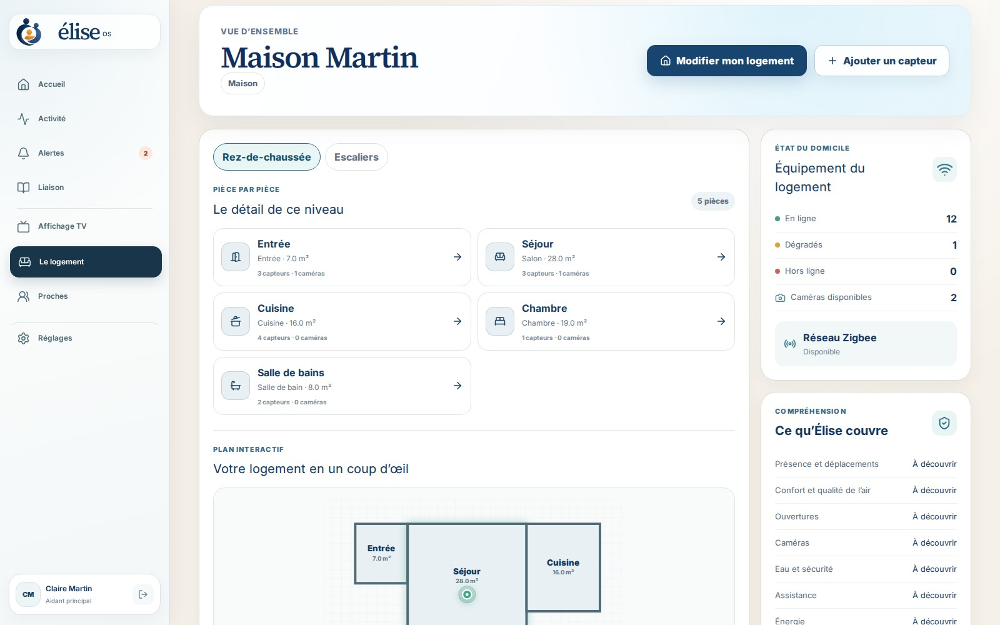                               |                               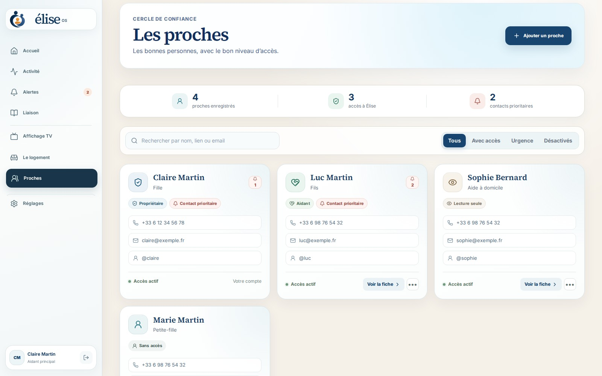                                |
|          **Le logement** — pièces, plan interactif, état des capteurs et réseau Zigbee, couverture par usage.          |                        **Proches** — le résident, les aidants, leurs rôles et leurs droits.                         |
|                            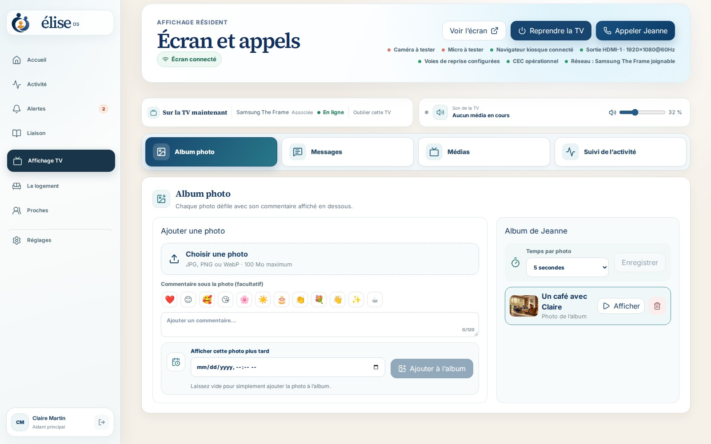                            |                              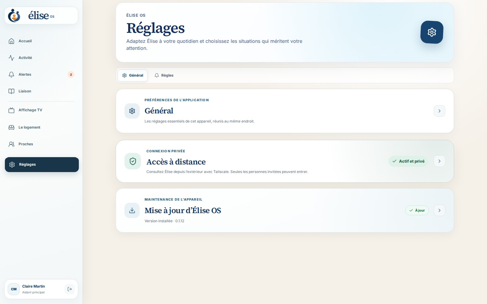                               |
|              **Affichage TV** — messages, photos, vidéos, programme et appels envoyés à l’écran du salon.              |                        **Réglages** — mises à jour, accès à distance, comptes, sauvegardes.                         |

### Télévision du résident

<div align="center">
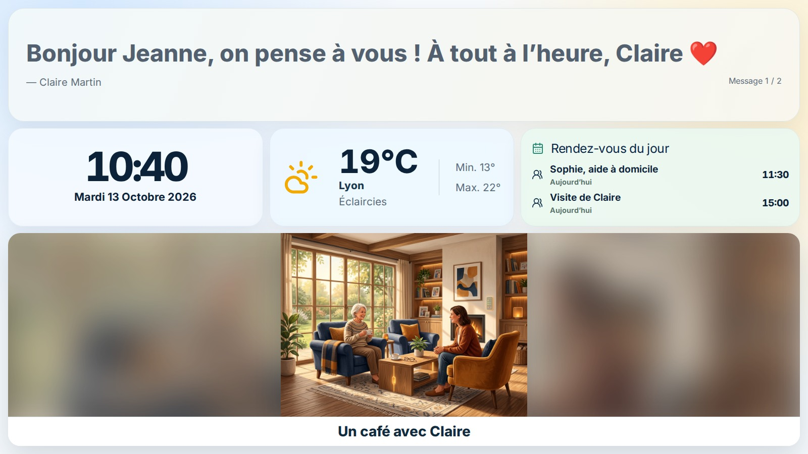
</div>

Un écran calme, lisible de loin : message du jour, heure, météo, rendez-vous et album photo. Les appels vidéo (Jitsi, auto-hébergé) s’annoncent par une mélodie progressive et se décrochent avec un simple bouton.

### Sur téléphone et ordinateur

|                                        Téléphone                                        |                              Ordinateur                               |
| :-------------------------------------------------------------------------------------: | :-------------------------------------------------------------------: |
| 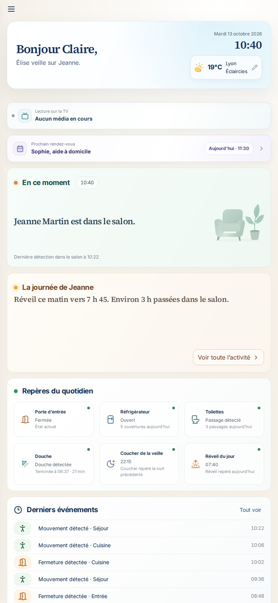 |  |

L’interface est entièrement responsive et disponible en français, anglais, espagnol, italien et portugais.

---

## Fonctionnalités

### Réassurance au quotidien

- Localisation de la dernière présence détectée, résumé de la journée en langage naturel.
- Repères du quotidien : lever, repas (réfrigérateur), toilettes, sorties, porte d’entrée.
- Apprentissage local des habitudes (Isolation Forest) avec **période d’apprentissage protégée de 14 jours**.
- Recommandations de couverture : Élise indique quelles pièces ou quels usages manquent de capteurs.

### Alertes explicables

- Détection des chutes, de la fumée, des fuites d’eau, porte ouverte trop longtemps, température anormale, inactivité inhabituelle…
- Règles d’alerte configurables par la famille, cycle de vie complet (ouverte → prise en charge → résolue) et historique auditable.
- Une panne de capteur produit une **alerte système explicite**, jamais une fausse conclusion d’inactivité.
- Notifications push au contenu minimal ; le détail reste derrière l’API authentifiée.

### Coordination des aidants

- Carnet de liaison partagé, calendrier des visites et rendez-vous, suivi des traitements.
- Rôles : propriétaire, administrateur, aidant ; invitation d’aidants par l’accès privé Tailscale.

### Écran TV et appels

- Interface résident plein écran sur HDMI/DisplayPort (Chromium en mode kiosque).
- Jusqu’à 20 messages défilants, photos, audio, vidéos, liens YouTube et flux HTTPS.
- Appels vidéo Jitsi auto-hébergés, décrochage automatique optionnel, bouton USB accepter/raccrocher.
- Allumage automatique de la TV par HDMI-CEC, Wake-on-LAN ou Home Assistant en secours.

### Maison et compatibilité

- **Tout appareil exposé à Home Assistant** : Zigbee (Zigbee2MQTT), Z-Wave, Matter, Wi-Fi, Bluetooth…
- Détection automatique de la clé Zigbee (Silicon Labs, Texas Instruments, ZiGate, deCONZ, ZBOSS).
- Entités inconnues visibles et associables à une capacité bornée (`ON_OFF`, `OPEN_CLOSED`, `NUMERIC`, `EVENT_ACTION`), sans code spécifique au modèle.
- Plan du logement interactif avec niveaux, pièces et équipements.

### Caméras (facultatives)

- Caméras locales RTSP / ONVIF via go2rtc, vision WebRTC sur session signée de 5 minutes.
- Mode confidentialité, interphone en push-to-talk, instantanés d’alerte conservés 24 h.
- Consentement explicite obligatoire pour chambres et salles de bain.

### Exploitation

- Image Raspberry Pi flashable, installateur Ubuntu en une commande, images conteneurs ARM64/AMD64.
- Mises à jour signalées par un badge, installées après confirmation, **retour automatique** si le contrôle de santé échoue.
- Secrets générés automatiquement, sauvegardes chiffrées (`age`), rétention automatique des données.

---

## Comment ça marche

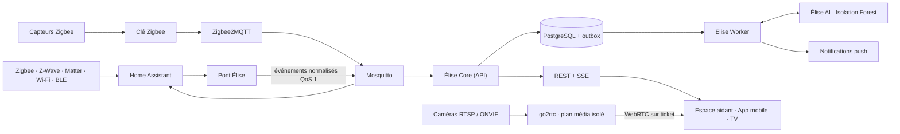

1. **Les capteurs** remontent via Home Assistant, qui sert de couche de compatibilité universelle.
2. **Le pont Élise** traduit les entités Home Assistant en _capacités_ (présence, ouverture, température…) et publie des événements normalisés, immuables et idempotents sur MQTT.
3. **Élise Core** (NestJS + Prisma) stocke les observations dans PostgreSQL et applique les règles. Une _outbox transactionnelle_ rend les traitements différés récupérables.
4. **Élise Worker** traite l’outbox : apprentissage, notifications, webhooks.
5. **Élise AI** (FastAPI + scikit-learn) évalue les écarts à la routine. Elle ne lit jamais le bus domestique et ne crée jamais d’alerte : seul Core décide, après une barrière de confiance et de persistance.
6. **Les interfaces** (tableau de bord React, app Expo, écran TV) consomment l’API REST et les flux SSE en temps réel.

Home Assistant, Zigbee2MQTT et Mosquitto sont des moteurs internes : ils n’apparaissent jamais dans l’expérience familiale. Les décisions d’architecture sont consignées dans [`docs/adr`](docs/adr).

---

## Garanties de sécurité

Élise est conçue autour d’invariants vérifiés par les tests :

1. Une panne de capteur produit une alerte système explicite, jamais une affirmation d’inactivité.
2. Un résultat d’apprentissage automatique exige confiance, persistance et validation par Core.
3. Au démarrage, seules les règles confirmées par la famille comptent ; l’apprentissage reste informatif au moins 14 jours complets.
4. Un événement rejoué ne peut créer ni observation en double, ni alerte SOS en double.
5. Les changements d’alerte sont des transitions en ajout seul, auditables.
6. Une capacité Home Assistant inconnue est visible mais n’entre dans aucune alerte avant d’être associée.
7. Les notifications push ne contiennent qu’un statut générique et un identifiant.
8. Une détection caméra négative ne prouve jamais une absence.
9. Identifiants, flux, images et audio des caméras n’entrent jamais dans les observations, l’IA, les notifications ou les journaux.
10. L’accès caméra est authentifié et audité ; le microphone fonctionne uniquement en push-to-talk.

---

## Vie privée

Tout le traitement est **local**. Aucun service cloud n’est requis pour fonctionner.

| Donnée                                    | Durée de conservation                     |
| ----------------------------------------- | ----------------------------------------- |
| Observations détaillées des capteurs      | 90 jours                                  |
| Tâches de livraison et données techniques | 30 jours                                  |
| Résumés du journal                        | jusqu’à 2 ans (par défaut)                |
| Comptes et journal d’audit                | jusqu’à suppression du compte ou du foyer |
| Instantanés d’alerte caméra               | 24 heures, exclus des sauvegardes         |
| Visio et audio                            | jamais enregistrés                        |

Détails : [docs/privacy.md](docs/privacy.md). Cette politique soutient la protection des données dès la conception mais ne constitue ni un avis juridique ni une certification RGPD.

---

## Matériel

| Élément  | Recommandation                                                                                                     |
| -------- | ------------------------------------------------------------------------------------------------------------------ |
| Boîtier  | **Raspberry Pi 4 avec 8 Go de RAM** (conseillé), ou Pi 5 8 Go, **ou** serveur Ubuntu 24.04 AMD64 / ARM64 avec 8 Go |
| Stockage | 32 Go minimum ; SSD USB ou NVMe (Pi 5) recommandé                                                                  |
| Radio    | Clé Zigbee USB (Sonoff, SMLIGHT, ConBee, ZiGate…) — facultative                                                    |
| Capteurs | Mouvement, ouverture, température/humidité, fuite d’eau, fumée, prise connectée, bouton SOS…                       |
| Écran    | Toute TV en HDMI ou DisplayPort ; webcam USB avec micro pour les appels dans les deux sens                         |
| Caméras  | Facultatives : toute caméra locale RTSP / ONVIF                                                                    |

Une liste d’achat indicative est disponible dans [docs/liste-achat-domadoo.md](docs/liste-achat-domadoo.md).

---

## Installation

### Raspberry Pi 4 / 5 (recommandé)

1. Installez [Raspberry Pi Imager](https://www.raspberrypi.com/software/).
2. Choisissez **Utiliser une image personnalisée** et l’image `elise-os-…img.xz` de la [dernière version](https://github.com/Elise-OS/EliseOS/releases/latest).
3. Dans les réglages d’Imager, indiquez le nom `elise`, votre Wi-Fi, le pays et le fuseau horaire. Pour SSH, choisissez une clé publique : l’image n’a aucun mot de passe par défaut.
4. Écrivez l’image, insérez le stockage et démarrez le Raspberry Pi.
5. Ouvrez **http://elise.local** (ou l’app Élise sur le même Wi-Fi) : la page « Préparation d’Élise » suit l’installation puis ouvre l’assistant de création du compte administrateur.
6. Associez Tailscale depuis l’assistant : la TV, Chromium, Jitsi et les permissions caméra/micro se configurent automatiquement.

La clé Zigbee peut être branchée avant ou après : Élise la détecte et choisit le bon pilote.

### Ubuntu Server 24.04

```bash
curl -fsSL https://github.com/Elise-OS/EliseOS/releases/latest/download/install-elise.sh | sudo bash
```

L’installateur vérifie la machine, installe Docker, Tailscale et Avahi, vérifie le manifeste signé de la version, télécharge les images pour votre architecture et attend que tous les services soient sains. Une installation existante, ses secrets et ses données sont conservés.

### Commandes d’administration

```bash
elise status      # état des services
elise logs        # journaux
elise update      # mise à jour (avec retour arrière automatique)
elise backup      # sauvegarde chiffrée
elise restore /var/lib/elise/backups/elise-AAAA.tar.age --confirm
elise uninstall   # conserve les données ; --purge pour tout supprimer
```

Chaque version publie l’image flashable, ses sommes et signatures, le catalogue Raspberry Pi Imager, l’installateur, l’APK Android et un manifeste de conteneurs épinglés par empreinte. Guide complet : [docs/installation.md](docs/installation.md).

---

## Accès à distance et application mobile

**Accès à distance.** Élise n’est jamais publiée sur Internet. La famille accède au boîtier par son réseau privé [Tailscale](https://tailscale.com), sur un port dédié en HTTPS. L’activation se fait en quatre étapes depuis les réglages ; voir [docs/acces-distant-prive.md](docs/acces-distant-prive.md).

**Application mobile « Élise OS – Companion ».** Disponible sur **iPhone et iPad (App Store)** et **Android** (APK publié avec chaque version). Elle découvre automatiquement le boîtier sur le réseau local (`_elise._tcp.local`), vérifie son identité, reçoit les notifications push et permet d’appeler le résident en visio ou d’envoyer des photos à la TV.

---

## Développement

### Prérequis

- Docker Engine 23+ avec Docker Compose
- Node.js 22 à 26 et pnpm 11
- Python 3.12+ (service IA)

### Démarrer la pile complète

```bash
cp .env.example .env
docker compose up -d
```

Sans matériel Zigbee, démarrez seulement le cœur :

```bash
docker compose up -d bootstrap postgres mosquitto ai api worker dashboard
```

Ouvrez **http://localhost:8080**. Sur une installation neuve, un assistant local en trois étapes crée le premier compte administrateur (accessible uniquement depuis le réseau local). Les secrets PostgreSQL, MQTT, IA et de session sont générés au premier démarrage dans un volume Docker privé.

> `ELISE_DEMO_MODE=true` active un compte de démonstration V0 (`paul@elise.local` / `Elise-Demo-2026!`), à réserver au développement.

Sur Raspberry Pi, activez la découverte mobile avec la surcouche dédiée :

```bash
docker compose -f compose.yaml -f compose.raspberry.yaml up -d
```

Pour détecter la clé Zigbee et écrire sa configuration :

```bash
pnpm zigbee:detect
```

### Travailler sur le code

```bash
pnpm install
pnpm db:generate
pnpm dev          # toutes les apps en parallèle
pnpm lint
pnpm typecheck
pnpm test
pnpm build
```

### Démonstration hors ligne

L’espace aidant possède un mode démonstration complet, sans serveur ni réseau (API simulée en mémoire, horloge figée) :

```bash
pnpm --filter @elise/dashboard exec vite --mode demo
```

Le scénario vit dans `apps/dashboard/src/demo/`. `bash scripts/build-landing-demo.sh` publie cette démo dans le site `eliselanding`.

### Développer sur Mac, tester sur un NAS

Docker n’est pas nécessaire sur le Mac : le code est synchronisé et construit sur un NAS joint par Tailscale.

```bash
cp config/nas-deploy.env.example config/nas-deploy.env
pnpm deploy:nas               # reconstruit ai, api, worker et dashboard
pnpm deploy:nas --dashboard   # chemin rapide pour un changement visuel
pnpm deploy:nas --dry-run     # aperçu sans rien modifier
bash scripts/dev-dashboard.sh # Vite en local, API sur le NAS
```

Le déploiement préserve le `.env`, les volumes, les secrets et les sauvegardes du NAS. Voir [README-NAS.md](README-NAS.md).

### Image Raspberry Pi

```bash
pnpm pi:image   # construit l’image
pnpm pi:flash   # écrit la dernière image construite sur une carte
```

### Intégration continue

Chaque push exécute `format:check`, `lint`, `typecheck`, `test` et `build` sur tout le monorepo, `ruff` et `pytest` sur le service IA, les tests de distribution et la validation de `compose.yaml`. Les versions sont publiées par [`release.yml`](.github/workflows/release.yml) ; l’APK Android par [`mobile-android-build.yml`](.github/workflows/mobile-android-build.yml).

---

## Structure du dépôt

```text
.
├── apps/
│   ├── api/          Élise Core — NestJS, Prisma, REST + SSE (alertes, capteurs, foyer, caméras, écran…)
│   ├── worker/       Traitement de l’outbox, notifications, tâches différées
│   ├── ai/           Service Python FastAPI de détection d’anomalies explicable
│   ├── dashboard/    Espace aidant et écran TV — React 19, Vite, Tailwind (+ mode démo)
│   └── mobile/       Application Expo / React Native pour iOS et Android
├── packages/
│   ├── contracts/    Schémas et types partagés entre API et clients
│   ├── ui/           Composants React partagés
│   ├── mqtt/         Client MQTT et sujets normalisés
│   ├── ai-client/    Client typé du service IA
│   ├── config/       Chargement et validation de la configuration
│   └── shared/       Utilitaires communs
├── appliance/        Image Raspberry Pi : premier démarrage, agents écran, mise à jour, accès distant
├── install/          Installateur Ubuntu et commande `elise`
├── docker/           Dockerfiles et configuration des services
├── scripts/          Déploiement NAS, sauvegarde, détection Zigbee, build d’image…
├── docs/             Architecture, ADR, installation, vie privée, caméras, écran TV
├── eliselanding/     Site public (sous-module Astro + Starlight)
└── compose*.yaml     Pile Docker (base, Raspberry Pi, release, maintenance)
```

---

## Pile technique

| Domaine        | Technologies                                                                                  |
| -------------- | --------------------------------------------------------------------------------------------- |
| API            | NestJS 11, Prisma 6, PostgreSQL 18, Server-Sent Events                                        |
| Interfaces     | React 19, Vite 7, Tailwind CSS 4                                                              |
| Mobile         | Expo 54, React Native 0.81, Expo Router                                                       |
| IA             | Python 3.12, FastAPI, scikit-learn (Isolation Forest)                                         |
| Domotique      | Home Assistant 2026.7, Zigbee2MQTT 2.13, Mosquitto 2                                          |
| Média          | go2rtc (WebRTC), Jitsi (visio auto-hébergée)                                                  |
| Infrastructure | Docker Compose, Tailscale, Avahi (mDNS), Ubuntu 24.04                                         |
| Outillage      | pnpm 11, Turborepo, TypeScript 5.8, Vitest, ESLint, Prettier, Ruff, Pytest, Husky, Commitlint |

---

## Documentation

| Sujet                               | Lien                                                       |
| ----------------------------------- | ---------------------------------------------------------- |
| Installation Raspberry Pi et Ubuntu | [docs/installation.md](docs/installation.md)               |
| Accès à distance privé              | [docs/acces-distant-prive.md](docs/acces-distant-prive.md) |
| Écran résident et appels            | [docs/ecran-resident.md](docs/ecran-resident.md)           |
| Architecture et invariants          | [docs/architecture.md](docs/architecture.md)               |
| Décisions d’architecture (ADR)      | [docs/adr](docs/adr)                                       |
| Développement, secrets, sauvegardes | [docs/development.md](docs/development.md)                 |
| Vie privée et rétention             | [docs/privacy.md](docs/privacy.md)                         |
| Caméras                             | [docs/cameras.md](docs/cameras.md)                         |
| Déploiement sur NAS                 | [README-NAS.md](README-NAS.md)                             |
| Documentation utilisateur complète  | [eliseos.paulbreton.dev](https://eliseos.paulbreton.dev)   |

---

## Contribuer, sécurité et licence

- **Contribuer** : lisez [CONTRIBUTING.md](CONTRIBUTING.md). Toute modification structurelle, de confidentialité ou de sécurité commence par un ADR. Les commits suivent [Conventional Commits](https://www.conventionalcommits.org/fr/).
- **Sécurité** : ne publiez jamais une vulnérabilité dans une issue ; suivez [SECURITY.md](SECURITY.md).
- **Licence** : [AGPL-3.0-only](LICENSE). © 2026 contributeurs d’Élise OS.

<div align="center">
<sub>Fait avec soin, pour Élise et pour toutes les familles qui veillent sur un proche.</sub>

<a href="https://buymeacoffee.com/drsamourai">☕ Élise OS est gratuit et open source : vous pouvez soutenir son développement sur Buy Me a Coffee.</a>
</div>
