<div align="center">


# Élise OS

**A plataforma de tranquilidade em casa, local e de código aberto, para famílias e cuidadores.**

Élise aprende os hábitos de uma casa graças a sensores discretos, assinala o que foge ao habitual
e liga o familiar idoso à sua família através da televisão da sala — sem nunca enviar os seus dados para a nuvem.

[](LICENSE)


[](https://buymeacoffee.com/drsamourai)

[🇫🇷 Français](README.md) · [🇬🇧 English](README.en.md) · [🇪🇸 Español](README.es.md) · [🇮🇹 Italiano](README.it.md) · **🇵🇹 Português**

[Demonstração online](https://eliseos.paulbreton.dev/demo/?lang=pt) · [Site e documentação](https://eliseos.paulbreton.dev/pt/) · [Transferir](https://github.com/Elise-OS/EliseOS/releases/latest) · [☕ Apoiar o projeto](https://buymeacoffee.com/drsamourai)

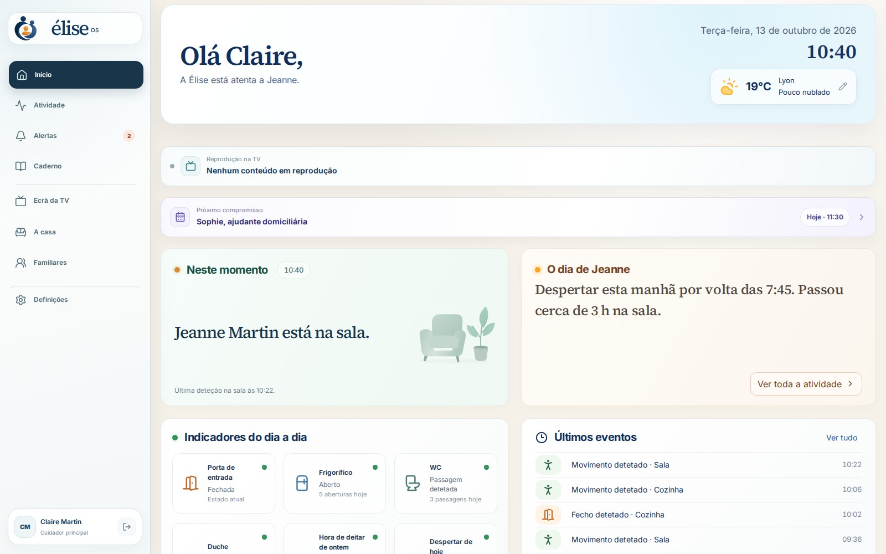

</div>

> [!IMPORTANT]
> O Élise OS é um produto de bem-estar. **Não é um dispositivo médico nem um serviço de emergência** e não substitui o acompanhamento profissional. Um estado «Tudo bem» significa que Élise dispõe de cobertura suficiente e não detetou qualquer anomalia, nunca uma garantia de segurança. Em caso de emergência, ligue 112.

---

## Índice

- [Porquê Élise?](#porquê-élise)
- [Capturas de ecrã](#capturas-de-ecrã)
- [Funcionalidades](#funcionalidades)
- [Como funciona](#como-funciona)
- [Garantias de segurança](#garantias-de-segurança)
- [Privacidade](#privacidade)
- [Equipamento](#equipamento)
- [Instalação](#instalação)
- [Acesso remoto e app móvel](#acesso-remoto-e-app-móvel)
- [Desenvolvimento](#desenvolvimento)
- [Estrutura do repositório](#estrutura-do-repositório)
- [Tecnologias](#tecnologias)
- [Documentação](#documentação)
- [Contribuir, segurança e licença](#contribuir-segurança-e-licença)

---

## Porquê Élise?

Quando um pai ou uma mãe envelhece sozinho em casa, a família vive entre duas preocupações: não saber, ou vigiar demasiado.
Élise propõe um terceiro caminho.

- **Tranquilizar sem filmar.** Sensores de movimento, de abertura, de temperatura ou de água bastam para perceber um dia. As câmaras são facultativas e ficam isoladas.
- **Compreender em vez de alarmar.** Élise aprende a rotina da casa durante 14 dias antes de as suas estimativas serem tidas em conta e explica cada alerta com factos datados.
- **Manter o laço.** A televisão torna-se um ecrã de família: mensagens, fotografias, compromissos do dia e videochamadas que começam com delicadeza.
- **Ficar em casa, à letra.** Tudo funciona num equipamento instalado em casa (Raspberry Pi ou servidor Ubuntu). O acesso remoto passa pela rede privada Tailscale da família, sem qualquer exposição na Internet.

O projeto é dedicado a Élise.

---

## Capturas de ecrã

Capturas da [demonstração pública](https://eliseos.paulbreton.dev/demo/?lang=pt): a «Casa Martin», uma família fictícia parada na terça-feira, 13 de outubro de 2026, às 10:40. Claire, a filha, cuida da mãe, Jeanne. As capturas abaixo mostram a interface em francês.

### Espaço do cuidador

|                                                                                                                 |                                                                                                                                         |
| :-------------------------------------------------------------------------------------------------------------: | :-------------------------------------------------------------------------------------------------------------------------------------: |
|                                                            |                                        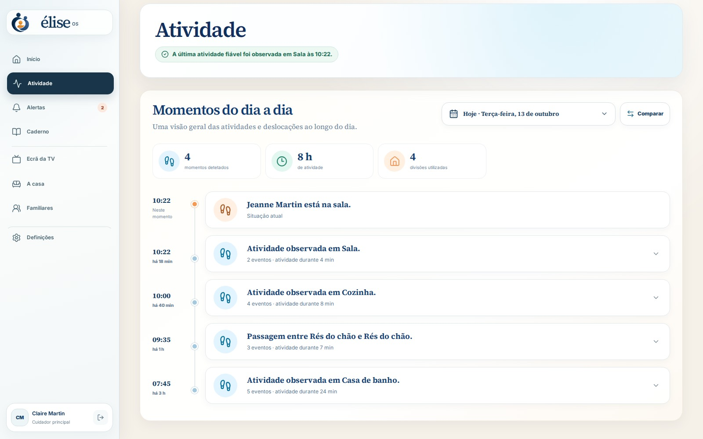                                        |
|   **Início** — onde está a Jeanne, o resumo do seu dia, os indicadores do quotidiano e o próximo compromisso.   |                              **Atividade** — o histórico das deslocações e dos eventos, divisão a divisão.                              |
|                             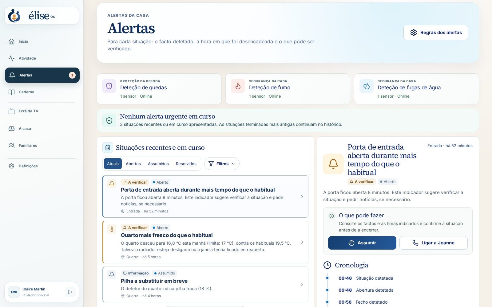                              |                                    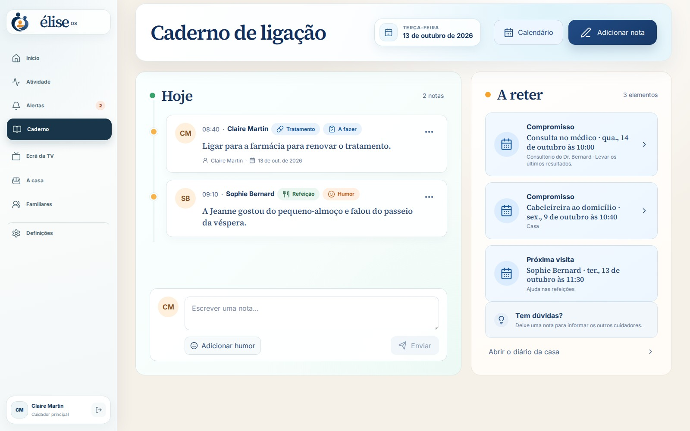                                    |
| **Alertas** — cada situação com o facto detetado, a hora e o que pode verificar; assume-se com um único clique. | **Caderno de ligação** — as notas partilhadas entre cuidadores (refeições, estado de espírito, tratamento) e os compromissos a lembrar. |
|                             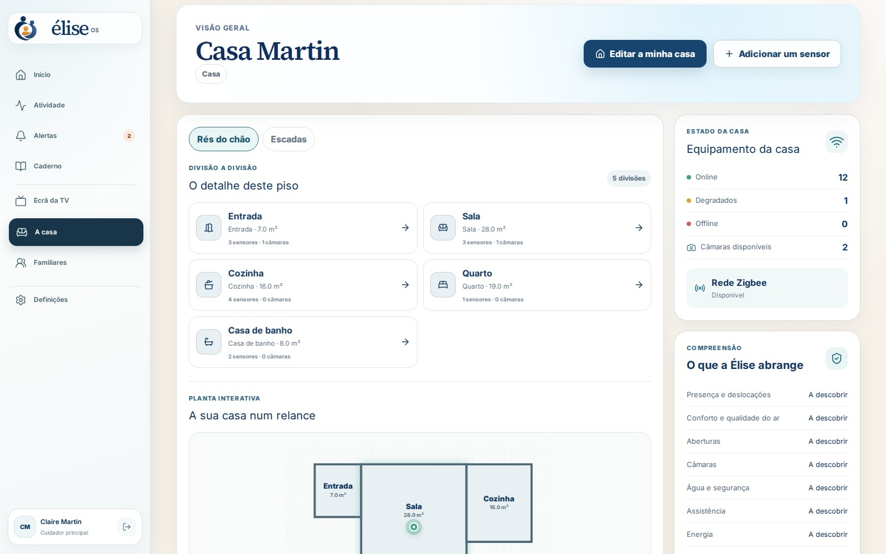                              |                                        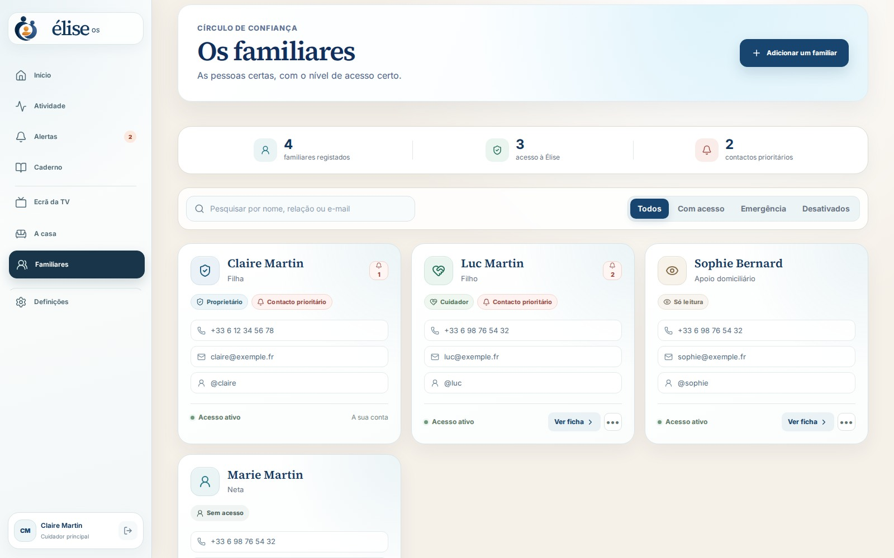                                        |
|    **A casa** — divisões, planta interativa, estado dos sensores e da rede Zigbee, cobertura por utilização.    |                          **Familiares** — o residente, os cuidadores, as suas funções e as suas autorizações.                           |
|                         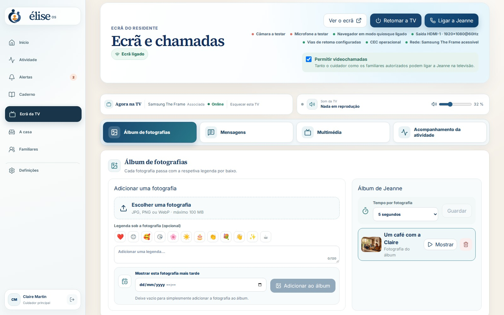                          |                                       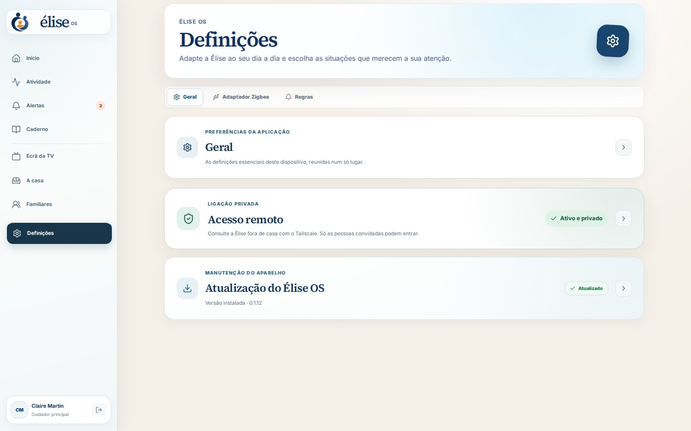                                        |
|      **Ecrã da TV** — mensagens, fotografias, vídeos, programação e chamadas enviados para o ecrã da sala.      |                                **Definições** — atualizações, acesso remoto, conta, cópias de segurança.                                |

### Televisão do residente

<div align="center">
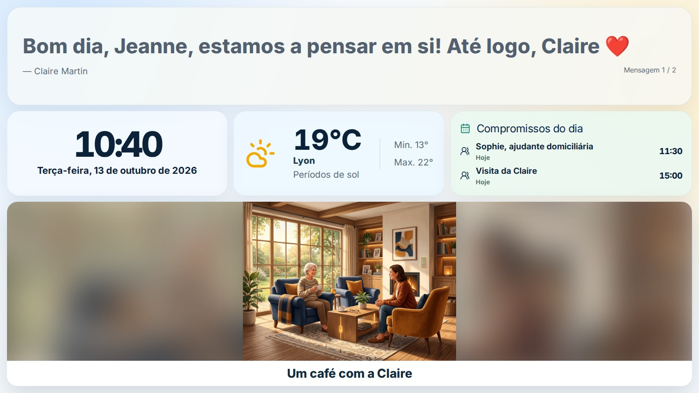
</div>

Um ecrã tranquilo, legível ao longe: mensagem do dia, hora, meteorologia, compromissos e álbum de fotografias. As videochamadas (Jitsi, auto-alojado) anunciam-se com uma melodia progressiva e aceitam-se com um simples botão.

### No telemóvel e no computador

|                                       Telemóvel                                       |                             Computador                              |
| :-----------------------------------------------------------------------------------: | :-----------------------------------------------------------------: |
| 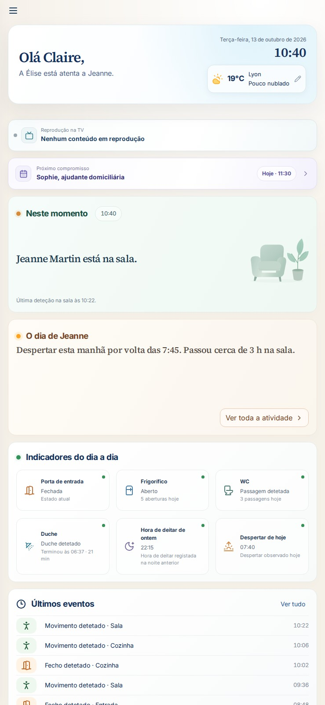 |  |

A interface adapta-se por completo a qualquer ecrã e está disponível em francês, inglês, espanhol, italiano e português.

---

## Funcionalidades

### Tranquilidade no dia a dia

- Localização da última presença detetada e resumo do dia em linguagem natural.
- Indicadores do quotidiano: levantar, refeições (frigorífico), casa de banho, saídas, porta de entrada.
- Aprendizagem local dos hábitos (Isolation Forest) com um **período de aprendizagem protegido de 14 dias**.
- Recomendações de cobertura: Élise indica que divisões ou que utilizações não têm sensores.

### Alertas explicáveis

- Deteção de possíveis quedas, fumo, fugas de água, porta aberta demasiado tempo, temperatura anómala, inatividade invulgar…
- Regras de alerta configuráveis pela família, ciclo de vida completo (aberto → assumido → resolvido) e histórico verificável.
- A avaria de um sensor gera um **alerta de sistema explícito**, nunca uma falsa conclusão de inatividade.
- Notificações push com conteúdo mínimo; os detalhes ficam atrás da API autenticada.

### Coordenação dos cuidadores

- Caderno de ligação partilhado, calendário de visitas e compromissos, acompanhamento dos tratamentos.
- Funções: proprietário, administrador, cuidador; convite dos cuidadores através do acesso privado Tailscale.

### Ecrã da TV e chamadas

- Interface do residente em ecrã inteiro por HDMI/DisplayPort (Chromium em modo quiosque).
- Até 20 mensagens em rotação, fotografias, áudio, vídeo, ligações do YouTube e fluxos HTTPS.
- Videochamadas Jitsi auto-alojadas, resposta automática facultativa, botão USB para aceitar ou terminar.
- Ligação automática da televisão por HDMI-CEC, Wake-on-LAN ou, em alternativa, Home Assistant.

### Casa e compatibilidade

- **Qualquer dispositivo exposto ao Home Assistant**: Zigbee (Zigbee2MQTT), Z-Wave, Matter, Wi-Fi, Bluetooth…
- Deteção automática do adaptador Zigbee (Silicon Labs, Texas Instruments, ZiGate, deCONZ, ZBOSS).
- As entidades desconhecidas ficam visíveis e podem ser associadas a uma capacidade delimitada (`ON_OFF`, `OPEN_CLOSED`, `NUMERIC`, `EVENT_ACTION`), sem código específico para cada modelo.
- Planta interativa da casa com pisos, divisões e dispositivos.

### Câmaras (facultativas)

- Câmaras locais RTSP / ONVIF através do go2rtc, visualização WebRTC numa sessão assinada de 5 minutos.
- Modo de privacidade, intercomunicador push-to-talk, imagens de alerta conservadas durante 24 h.
- Consentimento explícito obrigatório para quartos e casas de banho.

### Gestão e operação

- Imagem Raspberry Pi pronta a gravar, instalador Ubuntu com um único comando, imagens de contentores ARM64/AMD64.
- Atualizações assinaladas por um distintivo, instaladas após confirmação, com **reposição automática** se a verificação de integridade falhar.
- Segredos gerados automaticamente, cópias de segurança cifradas (`age`), conservação automática dos dados.

---

## Como funciona

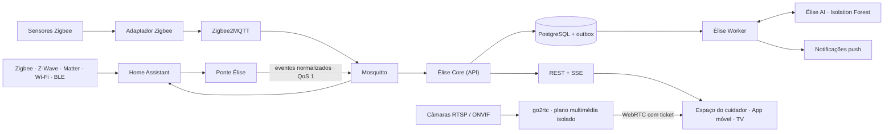

1. **Os sensores** enviam os seus dados através do Home Assistant, que serve de camada de compatibilidade universal.
2. **A ponte Élise** traduz as entidades do Home Assistant em _capacidades_ (presença, abertura, temperatura…) e publica no MQTT eventos normalizados, imutáveis e idempotentes.
3. **Élise Core** (NestJS + Prisma) guarda as observações no PostgreSQL e aplica as regras. Uma _outbox transacional_ torna recuperáveis os processamentos diferidos.
4. **Élise Worker** processa a outbox: aprendizagem, notificações, webhooks.
5. **Élise AI** (FastAPI + scikit-learn) avalia os desvios em relação à rotina. Nunca lê o barramento doméstico e nunca cria alertas: só o Core decide, depois de um filtro de fiabilidade e de persistência.
6. **As interfaces** (painel React, app Expo, ecrã da TV) usam a API REST e os fluxos SSE em tempo real.

Home Assistant, Zigbee2MQTT e Mosquitto são motores internos: nunca aparecem na experiência da família. As decisões de arquitetura estão reunidas em [`docs/adr`](docs/adr).

---

## Garantias de segurança

Élise foi concebida em torno de invariantes verificados por testes:

1. A avaria de um sensor gera um alerta de sistema explícito, nunca uma afirmação de inatividade.
2. Um resultado da aprendizagem automática exige fiabilidade, persistência e validação por parte do Core.
3. No início, só contam as regras confirmadas pela família; a aprendizagem permanece puramente informativa durante, pelo menos, 14 dias completos.
4. Um evento repetido não pode criar nem observações duplicadas nem alertas SOS duplicados.
5. As alterações de um alerta são transições apenas de adição e verificáveis.
6. Uma capacidade desconhecida do Home Assistant fica visível, mas não entra em nenhum alerta enquanto não for associada.
7. As notificações push contêm apenas um estado genérico e um identificador.
8. Uma deteção negativa de uma câmara nunca prova uma ausência.
9. Credenciais, fluxos, imagens e áudio das câmaras nunca entram nas observações, na IA, nas notificações nem nos registos.
10. O acesso às câmaras é autenticado e verificado; o microfone só funciona em modo push-to-talk.

---

## Privacidade

Todo o processamento é **local**. Não é necessário nenhum serviço na nuvem para funcionar.

| Dado                                  | Período de conservação                      |
| ------------------------------------- | ------------------------------------------- |
| Observações detalhadas dos sensores   | 90 dias                                     |
| Atividade de entrega e dados técnicos | 30 dias                                     |
| Resumos do caderno                    | até 2 anos (por predefinição)               |
| Conta e registo de auditoria          | até à eliminação da conta ou da casa        |
| Imagens de alerta das câmaras         | 24 horas, excluídas das cópias de segurança |
| Videochamadas e áudio                 | nunca gravados                              |

Detalhes: [docs/privacy.md](docs/privacy.md) (em inglês). Esta política favorece a proteção de dados desde a conceção, mas não constitui nem aconselhamento jurídico nem certificação RGPD.

---

## Equipamento

| Elemento      | Recomendação                                                                                                           |
| ------------- | ---------------------------------------------------------------------------------------------------------------------- |
| Dispositivo   | **Raspberry Pi 4 com 8 GB de RAM** (recomendado), ou Pi 5 de 8 GB, **ou** servidor Ubuntu 24.04 AMD64 / ARM64 com 8 GB |
| Armazenamento | Pelo menos 32 GB; recomenda-se um SSD USB ou NVMe (Pi 5)                                                               |
| Rádio         | Adaptador Zigbee USB (Sonoff, SMLIGHT, ConBee, ZiGate…) — facultativo                                                  |
| Sensores      | Movimento, abertura, temperatura/humidade, fuga de água, fumo, tomada inteligente, botão SOS…                          |
| Ecrã          | Qualquer televisão por HDMI ou DisplayPort; webcam USB com microfone para chamadas nos dois sentidos                   |
| Câmaras       | Facultativas: qualquer câmara local RTSP / ONVIF                                                                       |

Uma lista de compras indicativa está disponível em [docs/liste-achat-domadoo.md](docs/liste-achat-domadoo.md) (em francês).

---

## Instalação

### Raspberry Pi 4 / 5 (recomendado)

1. Instale o [Raspberry Pi Imager](https://www.raspberrypi.com/software/).
2. Escolha **Usar personalizado** e a imagem `elise-os-…img.xz` da [última versão](https://github.com/Elise-OS/EliseOS/releases/latest).
3. Nas definições do Imager, indique o nome `elise`, a sua rede Wi-Fi, o país e o fuso horário. Para o SSH, escolha a autenticação por chave pública: a imagem não tem palavra-passe predefinida.
4. Grave a imagem, insira o cartão e arranque o Raspberry Pi.
5. Abra **http://elise.local** (ou a app Élise na mesma rede Wi-Fi): a página «Preparação de Élise» acompanha a instalação e depois abre o assistente de criação da conta de administrador.
6. Emparelhe o Tailscale a partir do assistente: a televisão, o Chromium, o Jitsi e as autorizações de câmara e microfone configuram-se automaticamente.

O adaptador Zigbee pode ser ligado antes ou depois: Élise deteta-o e escolhe o controlador adequado.

### Ubuntu Server 24.04

```bash
curl -fsSL https://github.com/Elise-OS/EliseOS/releases/latest/download/install-elise.sh | sudo bash
```

O instalador verifica a máquina, instala o Docker, o Tailscale e o Avahi, confirma o manifesto assinado da versão, transfere as imagens para a sua arquitetura e aguarda que todos os serviços estejam em bom estado. Uma instalação existente, os seus segredos e os seus dados são conservados.

### Comandos de administração

```bash
elise status      # estado dos serviços
elise logs        # registos
elise update      # atualização (com reposição automática)
elise backup      # cópia de segurança cifrada
elise restore /var/lib/elise/backups/elise-AAAA.tar.age --confirm
elise uninstall   # conserva os dados; --purge para eliminar tudo
```

Cada versão publica a imagem pronta a gravar, as suas somas de verificação e as suas assinaturas, o catálogo do Raspberry Pi Imager, o instalador, o APK Android e um manifesto de contentores fixados por impressão digital. Guia completo: [docs/installation.md](docs/installation.md) (em francês).

---

## Acesso remoto e app móvel

**Acesso remoto.** Élise nunca é publicada na Internet. A família acede ao dispositivo através da sua rede privada [Tailscale](https://tailscale.com), numa porta dedicada em HTTPS. Ativa-se em quatro passos a partir das Definições; consulte [docs/acces-distant-prive.md](docs/acces-distant-prive.md) (em francês).

**App móvel «Élise OS – Companion».** Disponível para **iPhone e iPad (App Store)** e **Android** (APK publicado com cada versão). Encontra automaticamente o dispositivo na rede local (`_elise._tcp.local`), verifica a sua identidade, recebe as notificações push e permite fazer uma videochamada ao residente ou enviar fotografias para a televisão.

---

## Desenvolvimento

### Pré-requisitos

- Docker Engine 23+ com Docker Compose
- Node.js de 22 a 26 e pnpm 11
- Python 3.12+ (serviço de IA)

### Arrancar a stack completa

```bash
cp .env.example .env
docker compose up -d
```

Sem hardware Zigbee, arranque apenas o núcleo:

```bash
docker compose up -d bootstrap postgres mosquitto ai api worker dashboard
```

Abra **http://localhost:8080**. Numa instalação nova, um assistente local em três passos cria a primeira conta de administrador (acessível apenas a partir da rede local). Os segredos do PostgreSQL, do MQTT, da IA e da sessão são gerados no primeiro arranque, num volume Docker privado.

> `ELISE_DEMO_MODE=true` ativa uma conta de demonstração V0 (`paul@elise.local` / `Elise-Demo-2026!`), reservada ao desenvolvimento.

No Raspberry Pi, ative a deteção a partir do telemóvel com a camada adicional dedicada:

```bash
docker compose -f compose.yaml -f compose.raspberry.yaml up -d
```

Para detetar o adaptador Zigbee e escrever a respetiva configuração:

```bash
pnpm zigbee:detect
```

### Trabalhar no código

```bash
pnpm install
pnpm db:generate
pnpm dev          # todas as apps em paralelo
pnpm lint
pnpm typecheck
pnpm test
pnpm build
```

### Demonstração offline

O espaço do cuidador inclui um modo de demonstração completo, sem servidor nem rede (API simulada em memória, relógio parado):

```bash
pnpm --filter @elise/dashboard exec vite --mode demo
```

O cenário encontra-se em `apps/dashboard/src/demo/`. `bash scripts/build-landing-demo.sh` publica esta demonstração no site `eliselanding`.

### Desenvolver num Mac, testar num NAS

Num Mac não é necessário Docker: o código é sincronizado e compilado num NAS acedido através do Tailscale.

```bash
cp config/nas-deploy.env.example config/nas-deploy.env
pnpm deploy:nas               # recompila ai, api, worker e dashboard
pnpm deploy:nas --dashboard   # via rápida para uma alteração visual
pnpm deploy:nas --dry-run     # pré-visualização sem alterar nada
bash scripts/dev-dashboard.sh # Vite em local, API no NAS
```

O deploy conserva o `.env`, os volumes, os segredos e as cópias de segurança do NAS. Consulte [README-NAS.md](README-NAS.md) (em francês).

### Imagem Raspberry Pi

```bash
pnpm pi:image   # compila a imagem
pnpm pi:flash   # grava a última imagem compilada num cartão
```

### Integração contínua

Cada push executa `format:check`, `lint`, `typecheck`, `test` e `build` em todo o monorepo, `ruff` e `pytest` no serviço de IA, os testes de distribuição e a validação do `compose.yaml`. As versões são publicadas por [`release.yml`](.github/workflows/release.yml); o APK Android, por [`mobile-android-build.yml`](.github/workflows/mobile-android-build.yml).

---

## Estrutura do repositório

```text
.
├── apps/
│   ├── api/          Élise Core — NestJS, Prisma, REST + SSE (alertas, sensores, casa, câmaras, ecrã…)
│   ├── worker/       Processamento da outbox, notificações, tarefas diferidas
│   ├── ai/           Serviço Python FastAPI de deteção de anomalias explicável
│   ├── dashboard/    Espaço do cuidador e ecrã da TV — React 19, Vite, Tailwind (+ modo demo)
│   └── mobile/       Aplicação Expo / React Native para iOS e Android
├── packages/
│   ├── contracts/    Esquemas e tipos partilhados entre a API e os clientes
│   ├── ui/           Componentes React partilhados
│   ├── mqtt/         Cliente MQTT e tópicos normalizados
│   ├── ai-client/    Cliente tipado do serviço de IA
│   ├── config/       Carregamento e validação da configuração
│   └── shared/       Utilitários comuns
├── appliance/        Imagem Raspberry Pi: primeiro arranque, agentes do ecrã, atualização, acesso remoto
├── install/          Instalador Ubuntu e comando `elise`
├── docker/           Dockerfiles e configuração dos serviços
├── scripts/          Deploy no NAS, cópias de segurança, deteção Zigbee, compilação da imagem…
├── docs/             Arquitetura, ADR, instalação, privacidade, câmaras, ecrã da TV
├── eliselanding/     Site público (submódulo Astro + Starlight)
└── compose*.yaml     Stacks Docker (base, Raspberry Pi, release, manutenção)
```

---

## Tecnologias

| Âmbito         | Tecnologias                                                                                   |
| -------------- | --------------------------------------------------------------------------------------------- |
| API            | NestJS 11, Prisma 6, PostgreSQL 18, Server-Sent Events                                        |
| Interfaces     | React 19, Vite 7, Tailwind CSS 4                                                              |
| Móvel          | Expo 54, React Native 0.81, Expo Router                                                       |
| IA             | Python 3.12, FastAPI, scikit-learn (Isolation Forest)                                         |
| Domótica       | Home Assistant 2026.7, Zigbee2MQTT 2.13, Mosquitto 2                                          |
| Multimédia     | go2rtc (WebRTC), Jitsi (videochamadas auto-alojadas)                                          |
| Infraestrutura | Docker Compose, Tailscale, Avahi (mDNS), Ubuntu 24.04                                         |
| Ferramentas    | pnpm 11, Turborepo, TypeScript 5.8, Vitest, ESLint, Prettier, Ruff, Pytest, Husky, Commitlint |

---

## Documentação

| Tópico                                                     | Ligação                                                         |
| ---------------------------------------------------------- | --------------------------------------------------------------- |
| Instalação no Raspberry Pi e no Ubuntu (em francês)        | [docs/installation.md](docs/installation.md)                    |
| Acesso remoto privado (em francês)                         | [docs/acces-distant-prive.md](docs/acces-distant-prive.md)      |
| Ecrã do residente e chamadas (em francês)                  | [docs/ecran-resident.md](docs/ecran-resident.md)                |
| Arquitetura e invariantes (em inglês)                      | [docs/architecture.md](docs/architecture.md)                    |
| Decisões de arquitetura (ADR)                              | [docs/adr](docs/adr)                                            |
| Desenvolvimento, segredos, cópias de segurança (em inglês) | [docs/development.md](docs/development.md)                      |
| Privacidade e conservação (em inglês)                      | [docs/privacy.md](docs/privacy.md)                              |
| Câmaras (em inglês)                                        | [docs/cameras.md](docs/cameras.md)                              |
| Deploy no NAS (em francês)                                 | [README-NAS.md](README-NAS.md)                                  |
| Documentação completa do utilizador                        | [eliseos.paulbreton.dev/pt](https://eliseos.paulbreton.dev/pt/) |

---

## Contribuir, segurança e licença

- **Contribuir**: leia [CONTRIBUTING.md](CONTRIBUTING.md). Qualquer alteração estrutural, de privacidade ou de segurança começa por um ADR. Os commits seguem [Conventional Commits](https://www.conventionalcommits.org/).
- **Segurança**: nunca publique uma vulnerabilidade numa issue; siga [SECURITY.md](SECURITY.md).
- **Licença**: [AGPL-3.0-only](LICENSE). © 2026 colaboradores do Élise OS.

<div align="center">
<sub>Feito com carinho, para Élise e para todas as famílias que cuidam de uma pessoa querida.</sub>

<a href="https://buymeacoffee.com/drsamourai">☕ O Élise OS é gratuito e de código aberto: pode apoiar o seu desenvolvimento no Buy Me a Coffee.</a>
</div>
