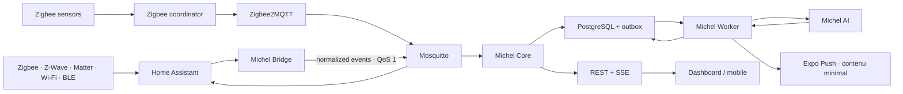

# Michel OS architecture

## Product boundary

Michel OS is the product. Home Assistant is an internal automation engine, Zigbee2MQTT is a radio adapter, and Mosquitto is a private transport. Neither Home Assistant nor Zigbee2MQTT is exposed in the normal family experience.

Michel OS is a wellbeing product, not a medical device or emergency service. A status of “normal” means that Michel has adequate sensor coverage and has not found a configured or learned anomaly; it is never a guarantee of safety.

## Runtime

The bridge maps Home Assistant domains and device classes into Michel capabilities. Manufacturer payloads and radio protocols are not business contracts. It also publishes a privacy-minimised registry inventory and scalar entity states. Unknown entities stay visible but are excluded from habits and alerts until an administrator assigns one of the bounded mappings (`ON_OFF`, `OPEN_CLOSED`, `NUMERIC` or `EVENT_ACTION`). Mappings are persisted in PostgreSQL; arbitrary executable transforms are never accepted. Events are immutable and idempotent; the transactional outbox makes delayed AI, webhook and push work recoverable.

## Domain boundaries

- **Identity**: local users, strong password hashes, sessions, memberships and roles.
- **Household**: organization, home, primary resident, caregivers, rooms and devices.
- **Sensing**: capability mapping, sensor health and immutable observations.
- **Routines**: calibration, habits, model artifacts and anomaly evaluations.
- **Alerts**: rules, policy gates, lifecycle transitions and notification delivery.
- **Care coordination**: journal, visits and appointments.
- **Platform**: configuration revisions, audit, retention, backup and health.

The initial deployment is a modular monolith plus one isolated Python ML service. Business modules may only depend inward on domain contracts. Michel AI cannot read the home bus or create alerts directly.

## Safety invariants

1. A sensor outage produces an explicit system alert, never an inactivity claim.
2. ML results require confidence, persistence and a Core policy gate.
3. Cold start uses only family-confirmed rules; learned scoring remains informational for at least 14 complete days.
4. Replayed events cannot create duplicate observations or SOS alerts.
5. Alert changes are append-only transitions and can be audited.
6. Unknown Home Assistant capabilities are visible but ineligible for alert logic until explicitly mapped.
7. Push notifications contain a generic status and an identifier only; details remain behind the authenticated local/Tailscale API.

## Compatibility policy

The V0 accepts every device exposed through Home Assistant, whether it arrives through Zigbee2MQTT, Z-Wave, Matter, Wi-Fi, Bluetooth or another Home Assistant integration. Each entity is classified as validated, recognized, partial, or unsupported. Community reports expand the matrix, but support by a transport or integration is not treated as universal Élise certification.

Zigbee pairing can be opened for a short, bounded session from the Élise administration screen. Devices on other protocols are added with their standard Home Assistant integration and appear on the next automatic or manual inventory refresh.

Production images pin Home Assistant and Zigbee2MQTT calendar releases. Bridge compatibility is tested against the pinned Home Assistant release and its immediate predecessor before upgrades.
